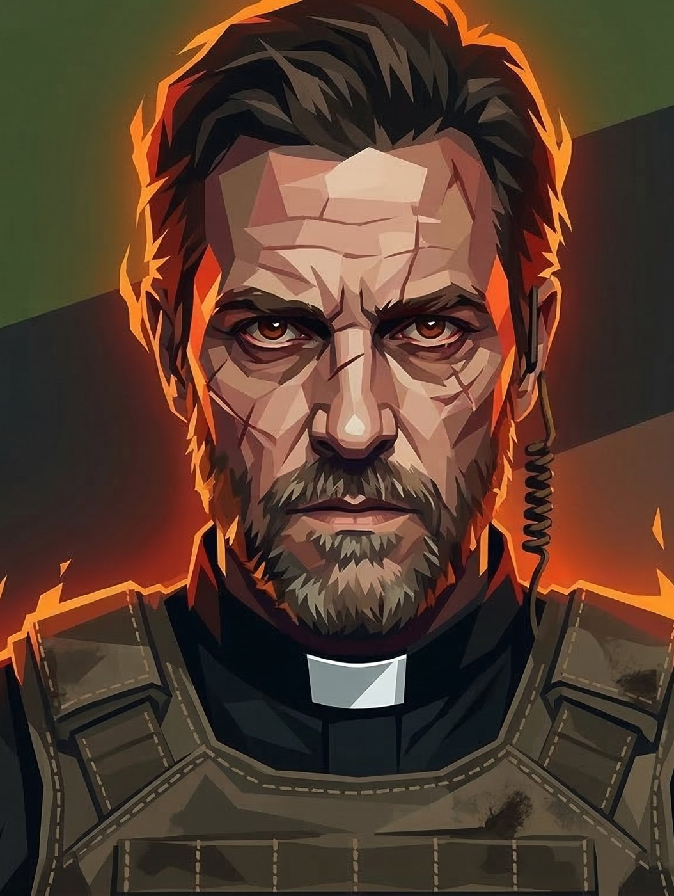

# Personagens

Fichas montadas a partir do quadro Trello "Vampire - The Mascarade", com as artes de cada card. Cada pasta tem a ficha (`README.md`), o `retrato.jpg` e as outras artes em até 1400 px. Os PNGs originais ficam na pasta do projeto, em `trello/artes/`.

## Camarilla

[Visão geral: Camarilla](camarilla/)

|  |  |  |  |
|---|---|---|---|
| [**Dante**](dante/) O Barão da Faria Lima _Ventrue_ | [**Luciana**](luciana/) A Arquitetura do Esquecimento _Tremere_ | [**Cão**](cao/) O Guardião dos Esgotos e da Máscara _Nosferatu_ | [**Isadora**](isadora/) A Musa de Sangue e Arte _Toreador_ |

|  |  |  |
|---|---|---|
| [**Dr Arnaldo (Excelentíssimo)**](dr-arnaldo/) A Balança de Ferro e Sangue _Banu Haqim_ | [**Padre Bernardo**](padre-bernardo/) O Pastor das Sombras Amigáveis _Malkaviano_ | [**Constance**](constance/) A Sombra da Ascensão _Lasombra_ |

## Anarchs

[Visão geral: Anarchs](anarchs/)

|  |  |  |  |
|---|---|---|---|
| [**Nego**](nego/) O Rei de Espadas do Asfalto _Gangrel_ | [**Guga**](guga/) O Coronel Sindical _Brujah_ | [**Vicenzo**](vicenzo/) O Don do Sangue Frio _Hecata_ | [**Harumi**](harumi/) A Senhora das Correntes de Seda _Ministério_ |

|  |
|---|
| [**Iara**](iara/) A Arquiteta das Miragens _Ravnos_ |

## Segunda Inquisição

[Visão geral: Segunda Inquisição](segunda-inquisicao/)

|  |  |  |  |
|---|---|---|---|
| [**Agente Rocha**](agente-rocha/) | [**Coronel Machado**](coronel-machado/) O Arquiteto da Purga | [**Dra. Elisa Camargo**](dra-elisa-camargo/) | [**Padre Tiago**](padre-tiago/) |

## Secundários

[Visão geral: Secundários](secundarios/)

|  |  |  |  |
|---|---|---|---|
| [**Irmão Silas**](irmao-silas/) O Pastor da Loucura _Malkaviano_ | [**Del Cavalcanti "O Limpador"**](del-cavalcanti/) O Cão do Estado _Banu Haqim_ | [**Biel**](biel/) O Chaveiro das Ruas _Sangue-Ralo_ | [**Nonna Benedetta**](nonna-benedetta/) A Zeladora dos Mortos _Hecata_ |

|  |  |  |  |
|---|---|---|---|
| [**Dígito**](digito/) O Arquiteto do Ponto Cego _Nosferatu_ | [**Valentina**](valentina/) A Curadora de Gado _Toreador_ | [**Rayo**](rayo/) O Pista (Coyote) _Gangrel_ | [**Mãe Silvia**](mae-silvia/) A Consultora da Cura _Tremere_ |

|  |
|---|
| [**Paizão**](paizao/) O Logístico _Ministério_ |

## A Aventura

[Visão geral: Prólogo - O Loft](prologo-o-loft/)
