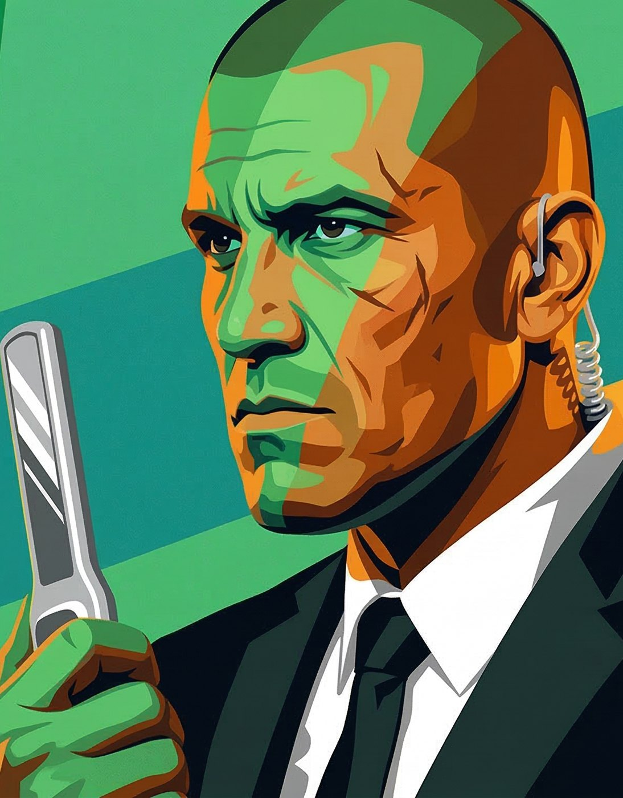
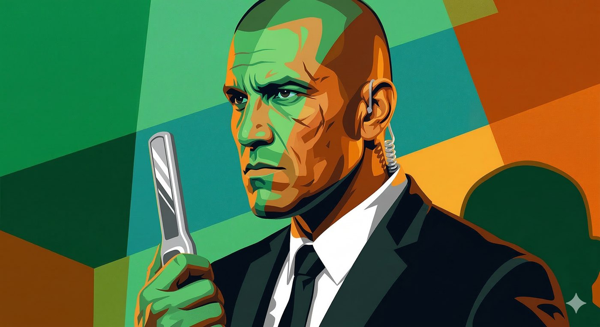

# Agente Rocha

**Facção:** Segunda Inquisição · [Card no Trello](https://trello.com/c/hbhlxqrL)

#### **Refino e Melhoria (Horror Hook para a Mesa)**

O horror do Rocha é a **Imunidade Silenciosa**. Vampiros estão acostumados a usar _Presença_ ou _Dominação_ para conseguir o que querem de humanos. Rocha foi treinado para resistir a isso. Quando um jogador tentar seduzi-lo ou controlá-lo com a Besta, ele não vai reagir como um mortal comum assustado. Ele vai dar um sorriso mínimo e gelado, anotar mentalmente a infração e dizer: _"Desculpe, senhor. Regras da casa."_ Ele é a prova de que a Máscara está caindo por dentro.

---

### **Ficha Mecânica (V5 NPC - Caçador Tático)**

_(Use estas paradas de dados quando os jogadores interagirem com ele ou entrarem em combate)_

- **Dificuldade Base:** 3 (Role as Paradas Excepcionais se os jogadores tentarem algo diretamente contra as especialidades dele).
- **Paradas de Dados Padrão:** Físico 5, Mental 4, Social 3.
- **Atributos Secundários:** Vitalidade 7, Força de Vontade 6.
- **Paradas de Dados Excepcionais:** * _Armas de Fogo:_ 6
  - _Briga (Corpo a Corpo):_ 6
  - _Percepção (Identificar Vampiros):_ 7 (Impulsionado por equipamento)
  - _Intimidação:_ 5
  - _Furtividade (Passar despercebido na multidão):_ 5

**Equipamento Especial & "Disciplinas" da Inquisição:**

- **Condicionamento de Estado (Mente Inescrutável):** Rocha recebe +2 Dados (+2 de Dificuldade para o jogador) para resistir a qualquer poder de _Dominação_ ou _Presença_. Se o poder falhar, ele sabe imediatamente que tentaram mexer na mente dele.
- **O Bastão "Scanner":** O que parece ser um detector de metais comum é, na verdade, um leitor térmico e de radiofrequência (RFID) sintonizado para o chip da Coterie.
- **Lentes de Contato Termais:** Ele usa lentes especiais (ou óculos escuros de segurança) que anulam penalidades de escuridão total e permitem ver assinaturas de calor. Vampiros aparecem como "buracos azuis" na visão dele, a menos que usem _Rubor de Vida (Blush of Life)_. Se um vampiro usar Vitae (aumentando a temperatura) perto dele, ele enxerga o brilho na hora.
- **Armamento Oculto:** Ele carrega uma pistola 9mm sob o paletó (dano +2). Se a situação for letal e ele precisar quebrar o disfarce, o carregador secundário tem balas de Fósforo Branco (causam Dano Agravado em Membros).

---

**Dica de Narrador:** Rocha é perigoso porque ele não ataca. Se os jogadores o espancarem no beco do MASP, eles matam um segurança, perdem humanidade e o BOES confirma que a Coterie é hostil, acionando a caçada aberta. Rocha é uma armadilha viva.

## Outras artes

---
_Texto e artes copiados do quadro Trello "Vampire - The Mascarade". Originais em alta resolução na pasta do projeto, em `trello/artes/originais/`._
