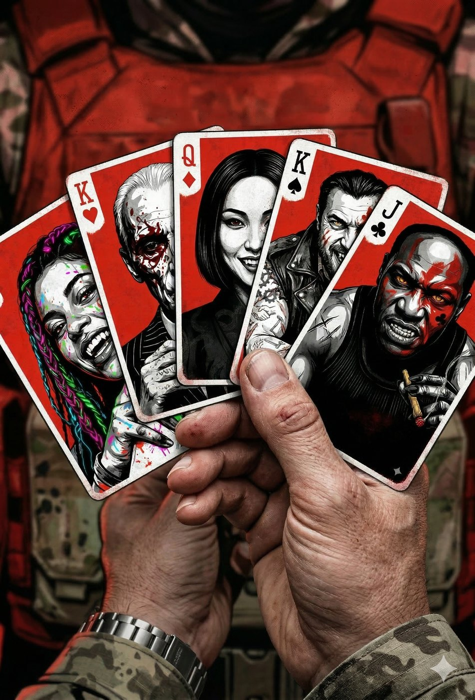
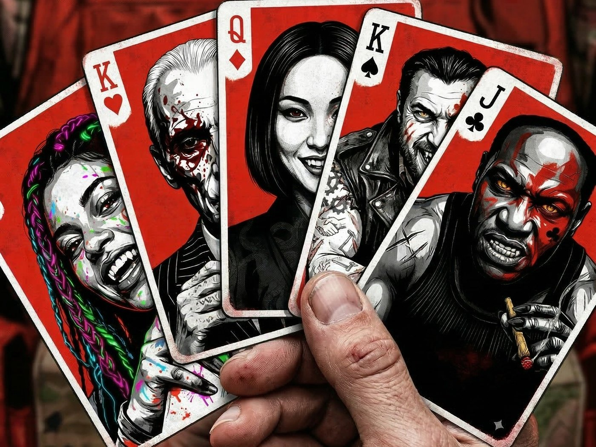

# Anarchs

**Facção:** Anarchs · [Card no Trello](https://trello.com/c/yWwnmdwX)

**Veredito:** Para fechar o nosso elenco com chave de ouro, precisamos entender a política da rua. O maior erro que os jogadores podem cometer é achar que os Anarquistas e os Independentes são uma "Liga da Justiça" unida contra a Camarilla.

**Crítica:** Eles se odeiam. A única razão pela qual o Príncipe Dante ainda governa São Paulo é porque os Barões estão ocupados demais medindo forças entre si. Se a Coterie quiser o apoio deles no Capítulo 4, vai ter que pisar em ovos para não ofender um Barão enquanto negocia com o outro.

Aqui está a teia de intrigas e facadas nas costas do submundo paulistano.

---

### **A Teia Anarquista e Independente (Fogo Amigo)**

- **Nego (Gangrel) vs. Guga (Brujah): O Choque de Classes da Rua**
  - _A Rixa:_ Nego acha que Guga virou um "revolucionário de ar-condicionado", que brinca de guerra com a vida dos peões enquanto enriquece com dinheiro de sindicato. Guga acha que Nego é um animal selvagem sem visão tática, que chafurda no lixo da Cracolândia em vez de organizar um exército de verdade. Eles se recusam a lutar juntos.
- **Harumi (Ministério) vs. Vincenzo (Hecata): A Guerra Fria dos Negócios**
  - _A Rixa:_ O Bixiga faz fronteira com a Liberdade. É a Velha Máfia contra a Nova Yakuza. Vincenzo lida com a morte e o fim das coisas; Harumi lida com o prazer e a escravidão em vida. Eles mantêm uma trégua educada e nunca se atacam diretamente, mas competem ferozmente pelo controle dos políticos e juízes mortais da cidade.
- **Iara (Ravnos) vs. Guga (Brujah): Geração Z vs. Boomer**
  - _A Rixa:_ Iara acha que parar uma fábrica de carros não muda o mundo; o que muda o mundo é hackear o sistema financeiro e viralizar a verdade. Guga acha as ilusões e o hip-hop da Iara uma "brincadeira de criança" que não resiste a um tiro de escopeta.
- **Iara (Ravnos) vs. Harumi (Ministério): Arte vs. Vício**
  - _A Rixa:_ Iara usa sua arte e influência na periferia para "acordar" os mortais para a realidade opressora. Harumi vende drogas e sangue para fazê-los "dormir" e aceitar a coleira. Iara tem um ódio pessoal por Harumi por ver o que os "insumos" do Ministério fazem com a juventude da Zona Sul.
- **Nego (Gangrel) vs. Vincenzo (Hecata): Os Abutres do Centro**
  - _A Rixa:_ Vincenzo frequentemente manda seus capangas (ou compra a polícia) para sequestrar moradores de rua e viciados do território do Nego para usar no tráfico de órgãos da máfia Hecata. Quando o Nego descobre, ele manda cabeças decapitadas de mafiosos italianos de volta para as cantinas da Mooca.

---

### **Atritos Externos (As Faíscas com o Topo e a Inquisição)**

- **Guga (Brujah) vs. Constance (Lasombra): Capital vs. Trabalho**
  - A rivalidade suprema. Toda vez que o Guga organiza uma greve que trava a logística de São Paulo, é a Constance quem compra a dívida da empresa, demite todo mundo e manda a Tropa de Choque descer o cassetete. O Guga quer a cabeça da Constance em uma lança.
- **Iara (Ravnos) vs. Dra. Elisa (Inquisição/ABIN): A Guerra de Dados**
  - É um xadrez de alto nível. Dra. Elisa odeia Iara profundamente. Os algoritmos preditivos do BOES são perfeitos, mas Iara cria tantos "falsos positivos", ilusões digitais e lixo eletrônico que os servidores da ABIN frequentemente entram em colapso. Elisa quer Iara dissecada viva para entender como a ilusão dela quebra a física das câmeras.
- **Harumi (Ministério) vs. Isadora (Toreador): O Monopólio da Elite**
  - Isadora organiza os Elísios da Camarilla (como no MASP) e se acha a dona da alta sociedade de São Paulo. Harumi organiza festas subterrâneas incrivelmente depravadas e rouba os melhores "brinquedos" mortais da Isadora. É uma guerra de vaidades banhada a sangue de luxo.
- **Nego (Gangrel) vs. Padre Tiago (Inquisição): Fogo e Fúria**
  - Para o Padre Tiago, as ocupações do Centro são as portas do inferno na Terra. Ele não faz relatórios; ele entra lá de dia com galões de querosene para queimar as barracas. O Nego já arrancou um braço de um dos assistentes do Padre Tiago. Se os dois se encontrarem na mesma rua, a cidade inteira vai tremer.
- **Vincenzo (Hecata) vs. Luciana (Tremere): Magia vs. Magia**
  - Luciana apaga memórias e cria escudos de sangue. Vincenzo fala com as almas que sobram dessas quebras mentais. Luciana acha a necromancia dele imunda e sem classe; Vincenzo sabe de todos os "erros" que a Luciana tentou enterrar, porque os fantasmas contam para ele. Ele é a única pessoa que pode chantagear a Senescal.

---

**Veredito de Narrador:** O elenco de São Paulo está 100% trancado e carregado. Você tem todas as motivações, as facas escondidas nas costas, as estatísticas de combate e as aparências cinematográficas. Se a sua Coterie tentar jogar um contra o outro, você sabe exatamente onde apertar para fazer a panela de pressão explodir.

## Outras artes

---
_Texto e artes copiados do quadro Trello "Vampire - The Mascarade". Originais em alta resolução na pasta do projeto, em `trello/artes/originais/`._
