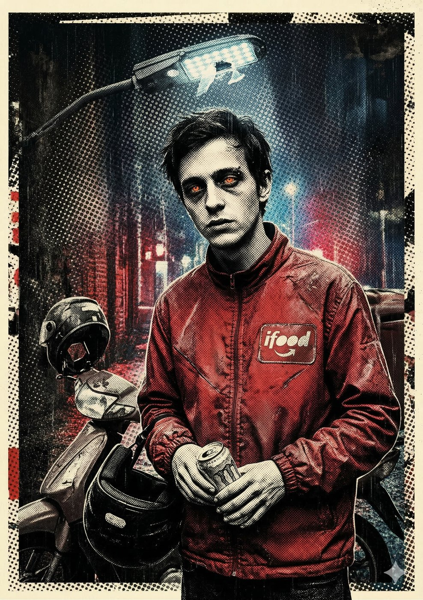

# Biel — O Chaveiro das Ruas

**Facção:** Secundários · **Clã:** Sangue-Ralo · [Card no Trello](https://trello.com/c/nZ85S0ZZ)

#### **Biel (Sangue-Ralo) - O Chaveiro das Ruas**

- **Função:** Entregador de iFood de madrugada. O radar e mensageiro dos Anarquistas.
- **Paradas Excepcionais:** Condução (Moto) 7, Manha 7, Furtividade 6.
- **Disciplinas-Chave:** _Alquimia de Sangue Ralo 2_ (Faz poções rápidas com sangue humano + energéticos/drogas).
- **O Truque:** Ele é praticamente indetectável pela Inquisição por ser "quase humano" (Rubor de Vida permanente). Se a Coterie precisar passar despercebida, ele é o Uber perfeito.

---
_Texto e artes copiados do quadro Trello "Vampire - The Mascarade". Originais em alta resolução na pasta do projeto, em `trello/artes/originais/`._
