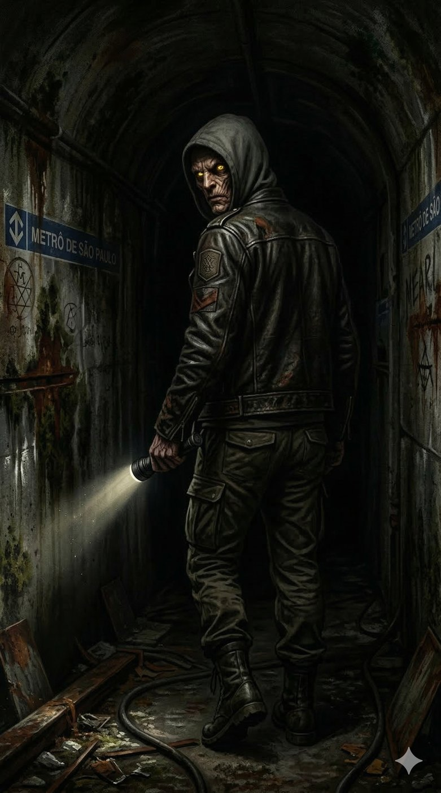
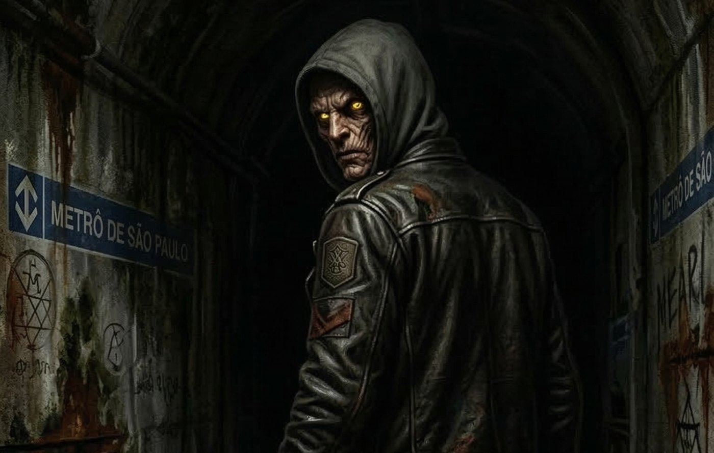
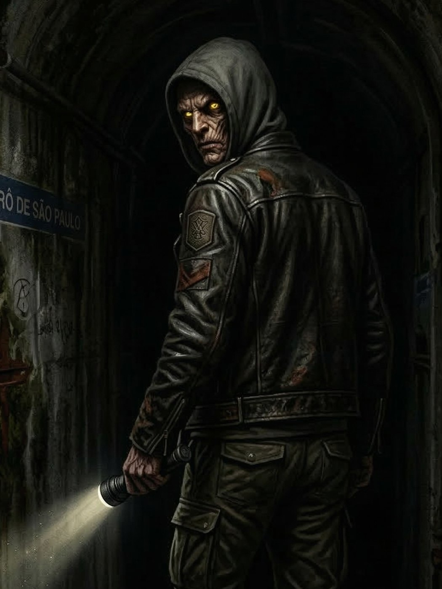

# Cão — O Guardião dos Esgotos e da Máscara

**Facção:** Camarilla · **Clã:** Nosferatu · [Card no Trello](https://trello.com/c/7FyGP1WJ)

**Veredito:** O Cão é a âncora de realidade física na sua crônica. Enquanto Dante cuida das finanças e Luciana da magia, o Xerife cuida do sangue derramado e dos corpos enterrados. Em São Paulo, onde o Sabá é um espectro e a Inquisição uma realidade térmica, um Nosferatu paranoico e brutal como Xerife é o único motivo pelo qual a Máscara ainda não caiu.

Aqui está a ficha do seu enforcador.

---

### **Cão: O Guardião dos Esgotos e da Máscara**

- **Clã:** Nosferatu (10ª Geração).
- **Idade:** ~70 anos (Aparenta ser uma deformidade sem idade. Abraçado na década de 1950, durante a rápida industrialização).
- **Posição:** Xerife de São Paulo.
- **Atributos de Destaque:** Força 4, Vigor 5 (Resistência brutal), Raciocínio 4 (Tática de guerrilha), Intimidação 5.
- **Disciplinas:** Potência 3 (Força bruta para quebrar ossos), Ofuscação 4 (Para ser o monstro que ninguém vê chegar), Animalismo 2 (Controlando a "fauna urbana" como espiões).
- **Predição (Bane):** _Repulsivo_. A aparência do Cão é monstruosa e inumana; ele nunca pode ter um nível de Aparência acima de 0. Ele não pode se passar por humano sem Ofuscação avançada. _Compulsão:_ _Secretismo_. Quando o Cão decide esconder algo, ele se torna obsessivo em garantir que nenhuma pista permaneça, mesmo que isso exija custos drásticos.

#### **História Resumida**

Ninguém sabe seu nome real. Ele foi abraçado nos esgotos de São Paulo durante uma época de repressão política, talvez um dissidente que "desapareceu" nas mãos do DOPS e foi encontrado por um Nosferatu sádico. No Mundo das Trevas, ele subiu ao poder por pura eficiência e brutalidade. Ele não se importa com política, apenas com a sobrevivência da Camarilla (e a dele). Ele aceitou o cargo de Xerife porque isso lhe deu acesso a recursos para construir seu bunker impenetrável no subsolo da cidade, um local que ele sabe que será útil quando Dante cair.

#### **Percepção dos Outros**

- **Dante (Príncipe):** "O dono do canil. Eu faço o trabalho sujo, ele me dá o controle dos subterrâneos. Nossa relação é simples. Se ele quebrar as Tradições, eu quebro os dentes dele."
- **Luciana (Senescal):** "A bruxa de terno. A magia dela é útil para esconder segredos da Inquisição, mas ela é ambiciosa demais. Eu a vigio mais de perto do que ela imagina."
- **A Coterie (Jogadores):** "Canários quebrados. Eles exalam cheiro de medo e Dominação. São inúteis agora, mas se sobreviverem ao porto, podem se tornar cães de caça eficientes. Minha função é garantir que, se caírem, não façam barulho."

#### **Refino e Melhoria (V5 Hook)**

Para aprofundar o horror pessoal, o Cão não usa apenas animais para espionagem. Ele comanda uma rede de **Carniçais (Ghouls)** entre os coletores de material reciclável (os "catadores") e os moradores de rua do centro. Isso lhe dá uma "presença" física inigualável em São Paulo. Ele os paga com sangue e pequenos favores, criando um exército invisível que monitora a movimentação do BOES (SI) e dos Anarquistas. O horror está na exploração dessas pessoas vulneráveis em nome da "segurança" da Camarilla.

---

### **Descrição Visual para a Imagem**

Cão é uma visão de puro pesadelo. Ele é deformado, ageless, com pele curtida e cicatrizes que parecem queimaduras antigas, misturadas com mutações inumanas. Seus olhos são fundos, amarelos e intensos, brilhando no escuro. Ele veste roupas utilitárias e gastas: uma jaqueta de couro pesado sobre um moletom com capuz, calças cargo táticas e botas de combate.

## Outras artes

---
_Texto e artes copiados do quadro Trello "Vampire - The Mascarade". Originais em alta resolução na pasta do projeto, em `trello/artes/originais/`._
