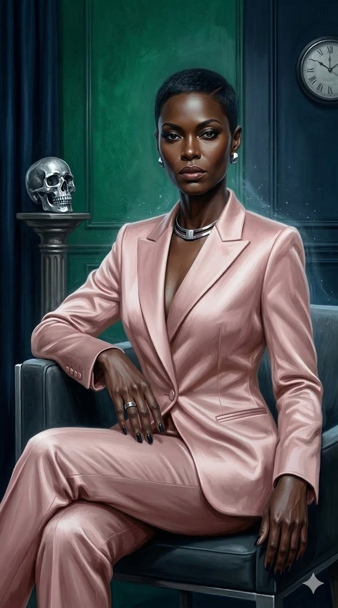
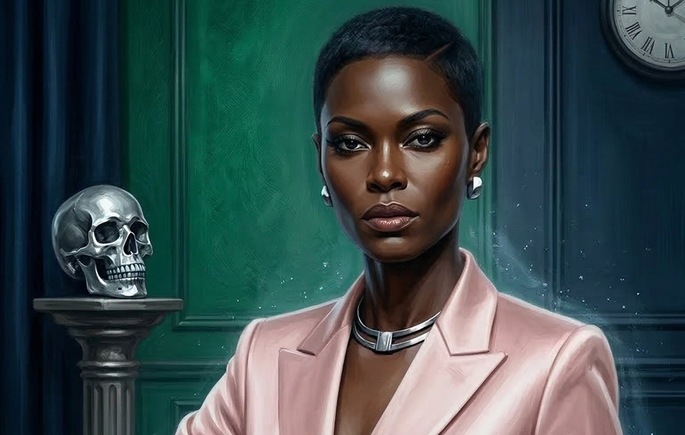
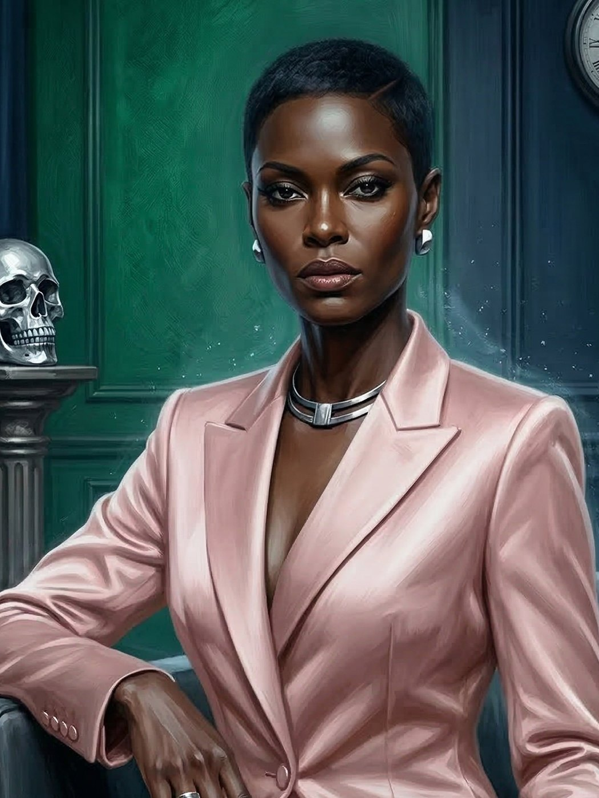

# Constance — A Sombra da Ascensão

**Facção:** Camarilla · **Clã:** Lasombra · [Card no Trello](https://trello.com/c/wTqJYFqO)

A **Constance** ser uma mulher preta não só melhora a representatividade, como eleva a história dela: imagine uma mulher negra operando como espiã industrial e ascendendo ao topo do capital financeiro na São Paulo dos anos 40/50. O nível de competência e frieza que ela precisou ter para dominar esses espaços é o que a torna a Lasombra perfeita.

Aqui está a ficha atualizada da Constance com a "Brasilidade" necessária.

---

### **Constance: A Sombra da Ascensão**

- **Clã:** Lasombra (9ª Geração).
- **Idade:** ~85 anos (Aparenta ter 40-45. Abraçada em 1943, durante o esforço industrial da Era Vargas).
- **Posição:** Primogênita Lasombra e Magnata do Setor Imobiliário.
- **Atributos de Destaque:** Inteligência 4, Manipulação 5 (Negociação implacável), Perseverança 5.
- **Disciplinas:** Oblivion 4 (Sombras e vácuo), Dominação 3, Potência 2.
- **Predição (Bane):** _Reflexo Distorcido_. Sua imagem em câmeras ou espelhos é uma silhueta de ébano trêmula que parece absorver a luz ao redor. Aparelhos eletrônicos costumam dar pane em suas mãos.
- **Compulsão:** _Crueldade (Ruthlessness)_.

#### **História Resumida**

Constance era uma das mentes mais brilhantes — e invisíveis — da inteligência industrial brasileira nos anos 40. Ela aprendeu cedo que, para uma mulher preta naquele tempo, o poder não era dado, era tomado nas sombras. Foi abraçada por um Lasombra que viu nela a mesma "fome de abismo" que define o clã. Ela não apenas sobreviveu à transição do Sabá para a Camarilla; ela foi a arquiteta dessa mudança em São Paulo, entregando os rivais em troca de uma cadeira no conselho de Dante. Ela é a dona silenciosa de metade dos prédios retrofitados do Centro.

#### **Percepção dos Outros**

- **Dante (Príncipe):** "Ele se acha o dono da Faria Lima porque herdou o nome. Eu sou a dona do chão onde o prédio dele foi construído. Dante é um sol poente; eu sou a noite que vem depois."
- **Luciana (Senescal):** "A bruxa branca e seus livros. Ela apaga memórias para o Príncipe; eu apago existências inteiras para o mercado. Somos parecidas, mas eu não preciso de rituais para ser temida."
- **A Coterie (Jogadores):** "Eles são como os investimentos de risco que eu faço na periferia. Podem quebrar ou podem dar um retorno extraordinário. Vou observar como eles lidam com o que 'esqueceram'."

#### **Refino e Melhoria (Brasilidade & Horror)**

Constance usa sua influência para o **Gentrificação de Sangue**. Ela compra cortiços e ocupações no centro, expulsa os Anarquistas e transforma os locais em "condomínios de luxo" para a Camarilla. O horror aqui é social: ela usa o sistema que a oprimiu em vida para oprimir seus inimigos agora. Para os jogadores, ela representa a "Dama de Ferro" — se eles precisam de recursos no Centro Velho, precisam passar por ela, e o preço dela nunca é apenas dinheiro.

---

### **Descrição Visual (Para sua narração)**

Constance é uma mulher preta de presença avassaladora. Ela mantém o cabelo em um corte _pixie_ milimetricamente desenhado. Suas roupas são o ápice do luxo minimalista: ternos de seda pesada em tons de azul meia-noite ou carvão que parecem fundir-se com as sombras da sala. Ela usa joias de prata raras (que contrastam lindamente com sua pele escura) e nunca usa relógios digitais, pois eles param em sua presença. Ela está sempre acompanhada por uma aura de frio antinatural.

## Outras artes

---
_Texto e artes copiados do quadro Trello "Vampire - The Mascarade". Originais em alta resolução na pasta do projeto, em `trello/artes/originais/`._
