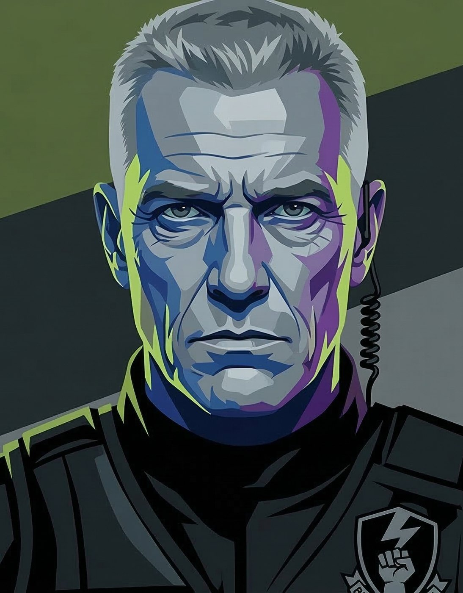
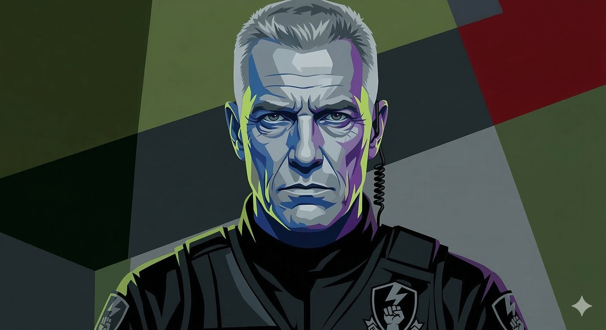

# Coronel Machado — O Arquiteto da Purga

**Facção:** Segunda Inquisição · [Card no Trello](https://trello.com/c/QtVOaTuQ)

**Veredito:** O Coronel Machado não é um monstro do Mundo das Trevas; ele é o monstro do mundo real. Na V5, a Segunda Inquisição não é feita de caçadores de estacas com alho pendurado no pescoço. Ela é feita de homens de farda, com orçamento do governo, drones e doutrina militar. Machado é o "Moses Gardner" da sua campanha, mas com o peso do Exército Brasileiro nas costas.

Se o Agente Rocha é a parede de tijolos, o Coronel Machado é o trator. Os jogadores não devem enfrentá-lo em combate direto sem um exército próprio ou um plano perfeito, ou vão virar cinzas.

Aqui está a ficha do homem que comprou a Coterie no Porto de Santos.

---

### **Coronel Machado: O Arquiteto da Purga**

- **Organização:** Comando Militar do Sudeste / BOES (Os Sagrados).
- **Idade:** 54 anos.
- **Posição:** Comandante de Operações (Operação Veritas).
- **Fachada:** Oficial linha-dura do Exército focado no combate ao narcotráfico e contrabando de armas nas fronteiras e portos.
- **Realidade:** O estrategista frio que orquestra a erradicação metódica dos "Corpos Vazios" (vampiros) em São Paulo, usando a Faria Lima e os Anarquistas uns contra os outros.

#### **História Resumida**

Machado era um tenente nos anos 90, época em que o Sabá dominava São Paulo e banhava as ruas de sangue sob o disfarce de "violência de gangues". Ele perdeu metade do seu pelotão em uma incursão na Zona Leste que deu muito errado. Ele viu a besta de perto e jurou que o Brasil não seria um pasto para parasitas imortais. Décadas depois, apoiado por inteligência do Vaticano e tecnologia de Israel, ele assumiu o BOES. Machado não tem ódio cego; ele tem nojo. Ele fez o acordo com o Príncipe Dante não por corrupção, mas por tática pura: _deixe os sanguessugas mais velhos encurralarem os mais novos, marque os traidores, mapeie a rede, e quando todos estiverem no mesmo buraco, jogue a granada._

#### **Percepção dos Outros**

- **Príncipe Dante:** "Um cadáver de terno que acha que pode me comprar porque tem dinheiro. Ele me entregou os próprios soldados por covardia. Vou usar a arrogância dele para enforcar a raça toda."
- **Dra. Elisa:** "Minha arma mais afiada. A guerra moderna não é vencida com balas de prata, é vencida com metadados."
- **A Coterie:** "Ratos de laboratório. Eles acham que estão livres, mas a cada esquina que dobram, eles desenham o mapa do covil para a minha artilharia."

#### **O Gatilho da Memória (Horror Hook para a Mesa)**

Sempre que a Coterie ouvir a voz grave do Coronel Machado — seja na televisão, em uma gravação do hacker Dígito, ou pessoalmente — **a tatuagem no lábio deles queima imediatamente**. É o trauma do Porto de Santos gritando no subconsciente. O corpo deles lembra do Coronel, mesmo que a mente tenha sido apagada pela Luciana.

---

### **Descrição Visual (Para ler na mesa)**

> "O homem na tela (ou do outro lado do pátio) exala uma autoridade pesada, do tipo que não precisa gritar para ser obedecido. Ele tem o cabelo grisalho cortado no padrão militar impecável, e o rosto é uma máscara de granito com rugas de expressão profundas ao redor dos olhos e da boca. Ele veste a farda de combate camuflada ou um traje tático preto com a insígnia do batalhão. A postura é rigidamente ereta, as mãos cruzadas para trás. Mas são os olhos dele que gelam o sangue de vocês: são olhos analíticos, frios e mortos. Ele não olha para suspeitos; ele olha para alvos. Quando ele fala, a voz dele é um trovão contido, uma cadência militar que faz o subconsciente de vocês entrar em pânico e a marca na gengiva de vocês latejar com gosto de sangue e cinzas."

---

### **Ficha Mecânica (V5 NPC - Comandante da Inquisição)**

_(Se a Coterie for estúpida o suficiente para atacá-lo de frente)_

- **Dificuldade Base:** 5 (Ele é um chefe de campanha. Ações normais contra ele falham facilmente).
- **Paradas de Dados Padrão:** Físico 5, Mental 6, Social 6.
- **Atributos Secundários:** Vitalidade 7, Força de Vontade 8 (Vontade de ferro, praticamente imune a terror mundano).
- **Paradas de Dados Excepcionais:** * _Armas de Fogo (Fuzil de Assalto/Pistola):_ 8
  - _Liderança / Intimidação:_ 8
  - _Percepção / Tática:_ 7
  - _Briga (Combate Corpo-a-Corpo Militar):_ 6

**Equipamento Especial & Táticas do BOES:**

- **Imunidade de Comando:** Devido ao treinamento anti-terror extremo e doutrinação, Machado recebe +3 Dados para resistir a _Dominação_, _Presença_ ou _Ofuscação_. (Se um vampiro tentar desaparecer na frente dele, a mente tática dele deduz a trajetória).
- **O Enxame (Escolta Constante):** Machado _nunca_ anda sozinho. Ele sempre tem pelo menos 3 a 5 Operativos do BOES com ele (use a ficha do Agente Rocha, mas armados com fuzis e granadas flashbang).
- **Fuzil Tático (Munição Fósforo Branco/Dragon's Breath):** Se Machado sacar a arma primária (um fuzil customizado), ele não atira chumbo. Ele atira projéteis incendiários. Dano da arma é +3, e causa **Dano Agravado** imediato em vampiros devido ao fogo/química.
- **Ação de Liderança - "Fogo de Supressão":** Em combate, em vez de atacar, Machado pode rolar Liderança para coordenar sua equipe. Todos os capangas dele ganham +2 dados nos ataques daquele turno e as rolagens de Furtividade dos vampiros falham automaticamente devido à cobertura tática.
- **Suporte Aéreo (Rádio):** Se ele acionar o rádio no ombro, em 3 turnos um drone da SI equipado com metralhadora ou luz UV pesada desce sobre a área.

---

**Dica de Narrador:** Machado não é um cara para se vencer no soco; ele é o cara para se vencer na chantagem, na sabotagem ou no xadrez político. Se os jogadores quiserem ferrar com ele, precisarão vazar informações das operações ilegais dele para a mídia humana ou usar o Dr. Arnaldo (Juiz da Camarilla) para forçar um recuo político.

## Outras artes

---
_Texto e artes copiados do quadro Trello "Vampire - The Mascarade". Originais em alta resolução na pasta do projeto, em `trello/artes/originais/`._
