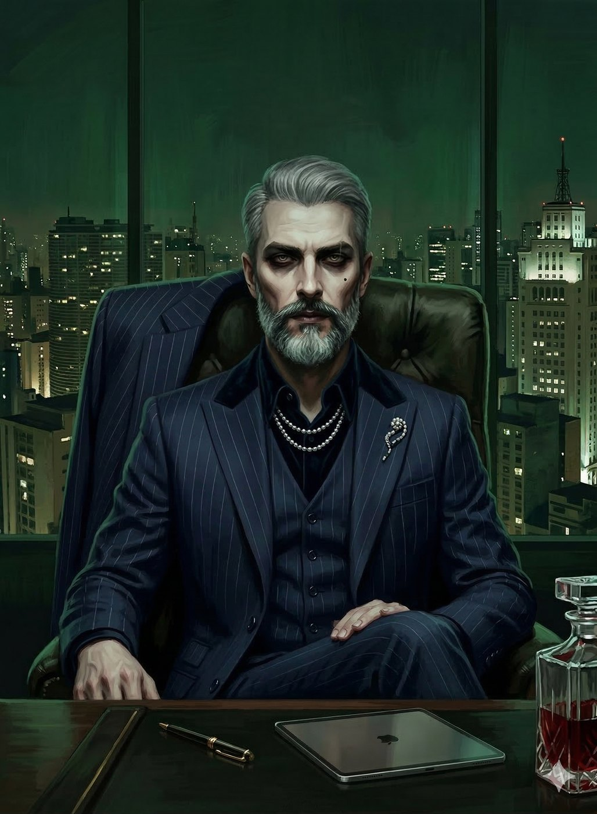
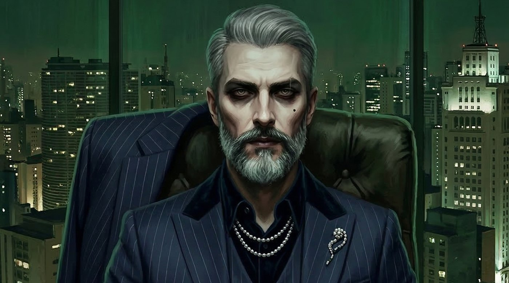
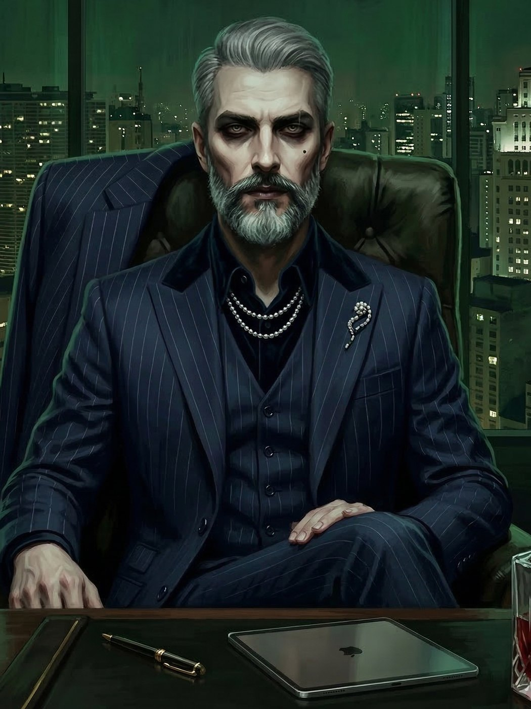

# Dante — O Barão da Faria Lima

**Facção:** Camarilla · **Clã:** Ventrue · [Card no Trello](https://trello.com/c/jGqmLMCy)

**Veredito:** Dante é o arquétipo do "Mal Necessário". Em São Paulo, um Príncipe que tenta ser um herói vira cinzas em uma semana. Ele precisa ser um gestor de crises. O fato de ele colaborar com a SI (BOES) não é por maldade, é por cálculo matemático: "Sacrifico dez para salvar mil". Isso o torna um antagonista (ou aliado) muito mais perigoso e complexo.

---

### **Dante: O Barão da Faria Lima**

- **Clã:** Ventrue (8ª Geração).
- **Idade:** ~160 anos (Abraçado em 1864, no auge do Império).
- **Posição:** Príncipe de São Paulo.
- **Atributos de Destaque:** Carisma 4, Manipulação 5, Inteligência 4.
- **Disciplinas:** Dominação 4, Presença 4, Fortitude 3.
- **Predição (Bane):** Dante só consegue se alimentar de **indivíduos que possuam poder de decisão direta sobre a vida de outros** (CEOs, juízes, oficiais de alto escalão). Sangue de "gente comum" é expelido como veneno.

#### **História Resumida**

Dante foi um barão do café que entendeu, antes de seus pares, que a terra morre, mas o capital é eterno. Ele sobreviveu à transição do Brasil Imperial para o Republicano manipulando o fluxo de crédito. No Mundo das Trevas, ele ascendeu durante o vácuo de poder deixado pela saída do Sabá de São Paulo nos anos 90/2000. Ele não conquistou a cidade com guerra, mas com execuções hipotecárias de refúgios e controle do sistema financeiro que os outros clãs usavam.

#### **Percepção dos Outros**

- **Luciana (Senescal):** "A faca que eu mantenho amolada. Ela acha que eu confio nela, o que a torna previsível. É a única que tem a competência necessária para manter o véu místico da cidade enquanto eu cuido do aço e do concreto."
- **Cão (Xerife):** "Um mal necessário. Ele fede a esgoto e segredos, mas é o único que não me olha com cobiça, apenas com fome. Enquanto eu lhe der ossos para roer, a cidade está segura."
- **A Coterie (Jogadores):** "Meus canários na mina. Eles viram algo que não deveriam, e agora são o meu experimento. Se eles sobreviverem ao 'tratamento' da Luciana e continuarem úteis, ótimo. Se começarem a lembrar demais... bem, São Paulo tem muitos cemitérios."

#### **Refino e Melhoria (Minha Sugestão)**

Para tornar Dante mais visceral, faça com que ele tenha um **Pilar (Touchstone)** que seja um descendente direto dele, talvez um bisneto que trabalha como estagiário em uma de suas empresas. Dante o observa de longe pelas câmeras de segurança. Ver o Príncipe, um monstro frio que vende irmãos para a inquisição, demonstrar um pingo de "humanidade" por um humano que nem sabe que ele existe, cria um contraste de horror pessoal excelente.

---

### **Descrição Visual para a Imagem**

Dante aparenta ter 45 anos. Ele usa um terno de corte italiano impecável, sem gravata (estilo _modern executive_ da Faria Lima). Seu rosto é anguloso, com uma barba rala perfeitamente aparada e cabelos grisalhos nas têmporas. O olhar é de alguém que não dorme há um século — olhos pesados, mas intensos. Ele está em um escritório de alto luxo no topo de um arranha-céu na Av. Paulista ou Faria Lima. Através da janela de vidro do chão ao teto, vemos as luzes infinitas e caóticas de São Paulo à noite, envoltas em uma leve névoa de poluição.

## Outras artes

---
_Texto e artes copiados do quadro Trello "Vampire - The Mascarade". Originais em alta resolução na pasta do projeto, em `trello/artes/originais/`._
