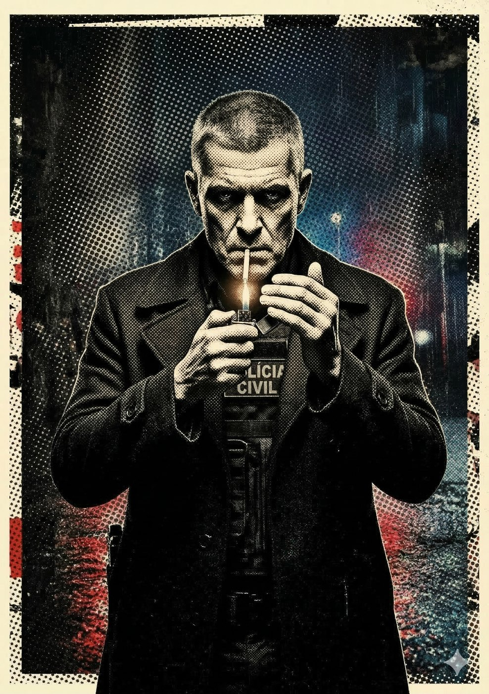

# Del Cavalcanti "O Limpador" — O Cão do Estado

**Facção:** Secundários · **Clã:** Banu Haqim · [Card no Trello](https://trello.com/c/wIU34snu)

#### **Delegado Cavalcanti (Banu Haqim) - O Cão do Estado**

- **Função:** Assassino tático da Camarilla disfarçado de Delegado linha-dura. Entrega Anarquistas pra Inquisição.
- **Paradas Excepcionais:** Armas de Fogo 8, Investigação (Policial) 8, Briga tática 7.
- **Disciplinas-Chave:** _Celeridade 3_, _Ofuscação 2_, _Feitiçaria de Sangue 2_ (Quietus - venenos/silêncio).
- **O Truque:** Se a Coterie quebrar a lei humana, Cavalcanti não manda o Xerife; ele manda uma viatura do GOE bater no refúgio de dia.

---
_Texto e artes copiados do quadro Trello "Vampire - The Mascarade". Originais em alta resolução na pasta do projeto, em `trello/artes/originais/`._
