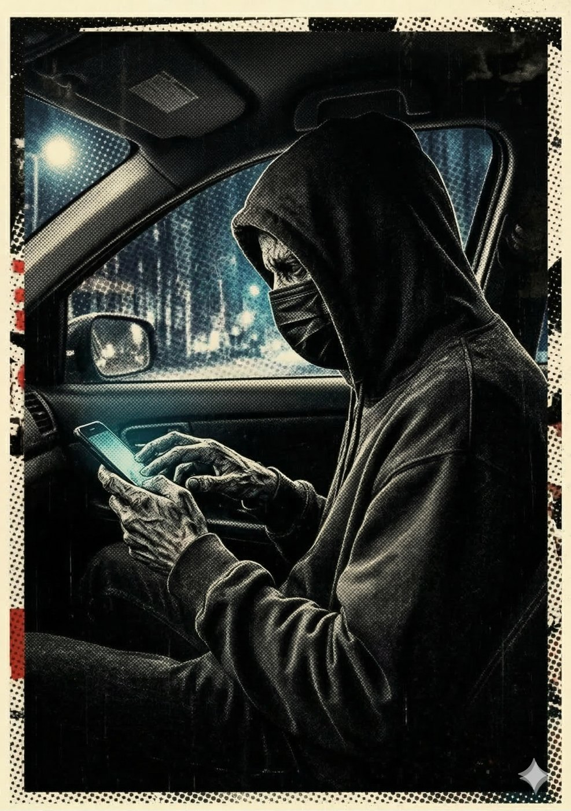

# Dígito — O Arquiteto do Ponto Cego

**Facção:** Secundários · **Clã:** Nosferatu · [Card no Trello](https://trello.com/c/LsiKBRnj)

#### **Dígito (Nosferatu) - O Arquiteto do Ponto Cego**

- **Função:** Hacker do Centro. É ele quem "apaga" vocês das câmeras de segurança da prefeitura.
- **Paradas Excepcionais:** Tecnologia (Hacker) 9, Investigação (Dados) 8, Furtividade 7.
- **Disciplinas-Chave:** _Ofuscação 3_ (Invisível até para câmeras), _Animalismo 2_ (Ratos que roem cabos de fibra ótica).
- **O Truque:** Ele é a única defesa real contra a Dra. Elisa (da Inquisição), mas é mercenário. Se a grana acabar, ele "esquece" de apagar o arquivo de vídeo de vocês caçando.

---
_Texto e artes copiados do quadro Trello "Vampire - The Mascarade". Originais em alta resolução na pasta do projeto, em `trello/artes/originais/`._
