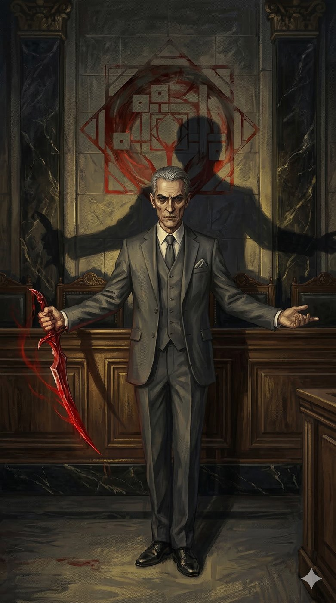
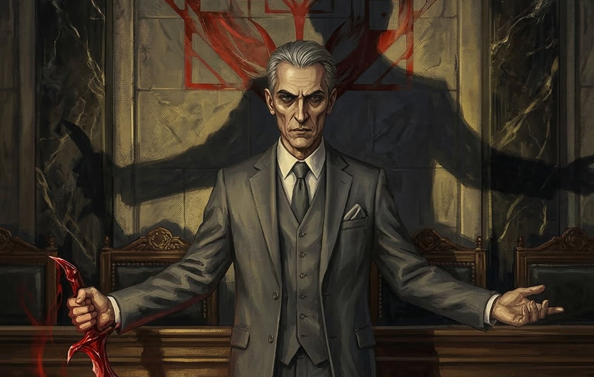
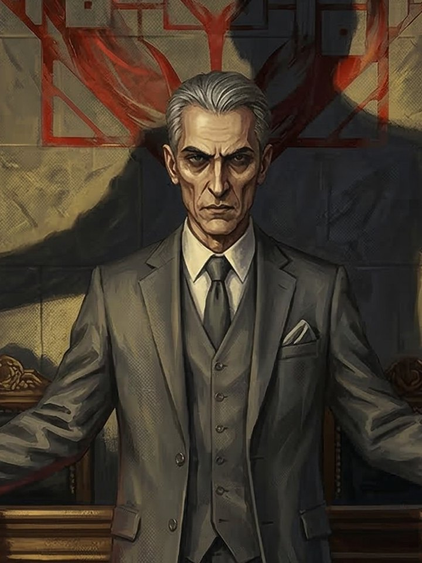

# Dr Arnaldo (Excelentíssimo) — A Balança de Ferro e Sangue

**Facção:** Camarilla · **Clã:** Banu Haqim · [Card no Trello](https://trello.com/c/DlQaduvJ)

**Veredito:** O Dr. Arnaldo é o elemento "noir" da sua São Paulo. Ele é a prova de que a "Justiça" na Camarilla é apenas um instrumento de controle político. Ele não busca a verdade; ele busca a ordem que o Príncipe deseja. Em termos de V5, ele é perigosíssimo porque sua Humanidade é baixa, mas sua Compostura é alta, o que o torna um psicopata frio e calculista, cujos sermões sobre moralidade são apenas a música que ele toca antes de cortar gargantas.

Aqui está a ficha do seu Primogênito Juiz/Carrasco.

---

### **Dr. Arnaldo: A Balança de Ferro e Sangue**

- **Clã:** Banu Haqim (9ª Geração).
- **Idade:** ~200 anos (Aparenta estar no fim dos 50. Abraçado em meados do século XIX, durante o Império).
- **Posição:** Primogênito dos Banu Haqim e Juiz da Corte.
- **Atributos de Destaque:** Raciocínio 5 (Análise tática e legal instantânea), Vigor 4 (Resistência inumana), Compostura 5 (Psicopatia controlada).
- **Disciplinas:** Ofuscação 4 (Para julgar sem ser visto), Celeridade 3 (Velocidade para a execução), Feitiçaria de Sangue 2 (Focada em rituais de detecção de mentiras e punição tática).
- **Predição (Bane):** _A Fome por Vitae Kindred_. Arnaldo sente uma fome avassaladora sempre que consome o sangue de outro vampiro. _Compulsão:_ _Julgamento_. Arnaldo é compelido a julgar as ações de todos ao seu redor de acordo com o seu próprio código rígido. Ele não consegue ignorar uma infração, não importa quão pequena, e deve punir ou relatar.

#### **História Resumida**

Nascido em uma família de magistrados imperiais, Arnaldo foi abraçado pelo clã (então conhecidos como Assamitas) não por sua habilidade de assassino, mas por sua mente legal obsessiva. Ele passou décadas refinando sua "Arte do Julgamento" no Oriente Médio e Europa, retornando ao Brasil pouco antes da Guerra da Gehenna esvaziar o Sabá de São Paulo. Ele se aliou a Dante porque o Ventrue prometeu a ele uma estrutura de poder onde ele poderia impor a "Verdadeira Lei de Caine" sobre a anarquia da capital. Ele não serve a Dante por lealdade, mas porque a praxis de Dante é a mais estável para os seus próprios propósitos.

#### **Percepção dos Outros**

- **Dante (Príncipe):** "Um gestor competente, mas focado demais no capital. Ele não entende que sem a Lei (a minha Lei), o capital dele é apenas pó. Eu sou o peso que mantém o trono dele no lugar."
- **Luciana (Senescal):** "Brinca com o Sangue como se fosse uma criança com tinta. A arrogância dela a levará a quebrar uma Tradição Mística. Quando ela o fizer, eu terei a prova, e o julgamento dela será... exemplar."
- **Isadora (Toreador):** "Uma abominação que anda. Ela cheira a sangue de inocentes e sua Humanidade está em frangalhos. Eu já preparei o 'processo' contra ela; estou apenas esperando ela cometer o erro final que a tornará um perigo inegável para a Máscara."
- **A Coterie (Jogadores):** "Anomalias. Testemunhas de um crime que a Senescal tentou apagar. Eu os vigio não com pena, mas com precisão. Se as mentes deles se corromperem e eles se tornarem perigosos, a minha justiça será rápida, silenciosa e final."

#### **Refino e Melhoria (V5 Hook/Horror)**

Para aprofundar o horror tático, o Dr. Arnaldo não "investiga" da forma tradicional. Ele usa **Feitiçaria de Sangue tática**. Ele mantém uma coleção de "amostras de sangue" de todos os Kindred influentes da cidade. Com rituais específicos, ele pode saber se alguém mentiu no Elísio ou se alguém se alimentou de uma Humanidade baixa, o que lhe dá um "dossiê" constante de chantagear e controlar a Corte. O horror é a vigilância constante e mística; na São Paulo de Arnaldo, você é culpado até que o sangue prove o contrário.

---

### **Descrição Visual para a Imagem (Sem Geração)**

Dr. Arnaldo aparenta estar no final dos 50 anos, de etnia luso-brasileira, com traços severos e angulosos que lembram uma ave de rapina. Seu cabelo é grisalho, curto e rigorosamente penteado. Seus olhos são escuros, profundos e transmitem uma frieza que parece sugar o calor do ambiente. Ele veste ternos clássicos de alfaiataria (não o estilo moderno da Faria Lima), com corte sóbrio e sem estampas, em tons de cinza chumbo ou azul marinho, com um lenço de bolso perfeitamente dobrado que esconde uma lâmina tática de Feitiçaria de Sangue. Ele está no antigo tribunal do Palácio da Justiça em São Paulo à noite, em um Elísio vazio. Ele está sentado na cadeira do juiz, iluminado apenas por uma luz fria e amarelada que projeta sombras grotescas e ameaçadoras nas paredes de mármore e madeira escura do local.

## Outras artes

---
_Texto e artes copiados do quadro Trello "Vampire - The Mascarade". Originais em alta resolução na pasta do projeto, em `trello/artes/originais/`._
