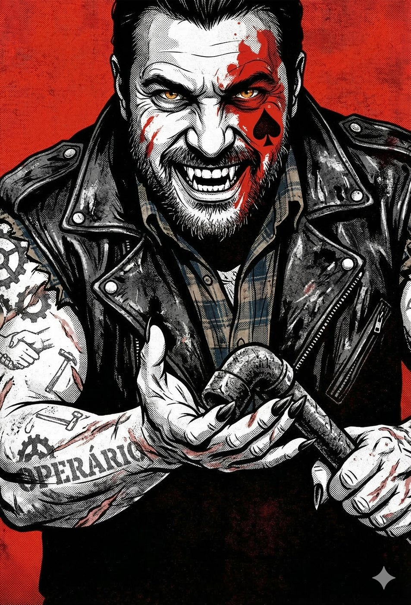
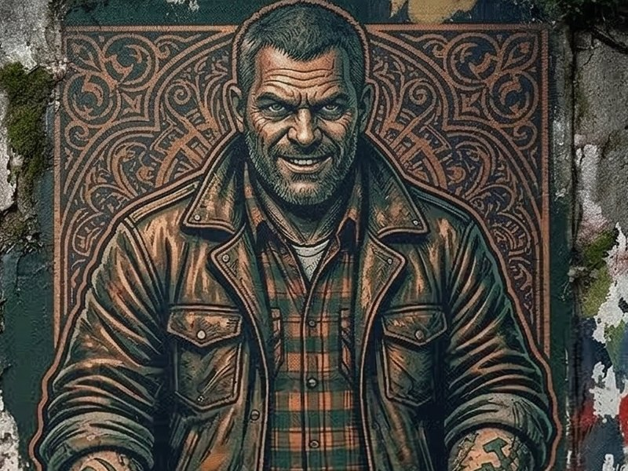
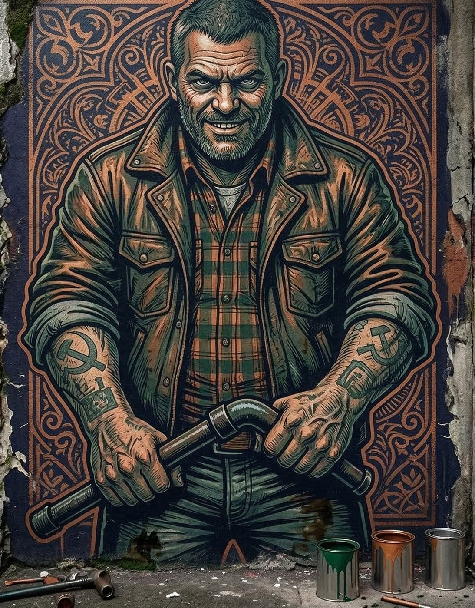
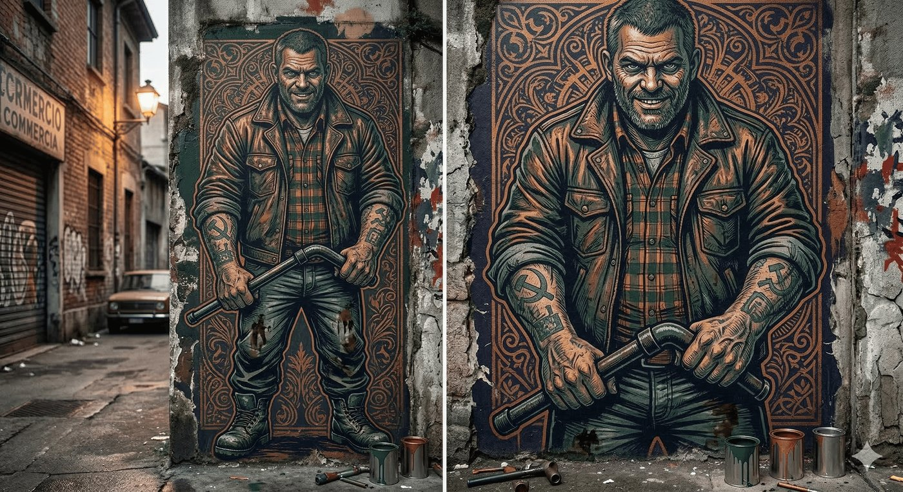

# Guga — O Coronel Sindical

**Facção:** Anarchs · **Clã:** Brujah · [Card no Trello](https://trello.com/c/ETRaJv4j)

**Veredito:** O ABC Paulista e a Zona Leste formam o cinturão industrial de São Paulo. Historicamente, é o berço do movimento sindical brasileiro. Na sua crônica, o Guga é a personificação dessa fúria operária, mas com o tempero trágico do Mundo das Trevas: a revolução dele foi corrompida pela Fome.

Se o Nego (Gangrel) é o instinto de sobrevivência puro da sarjeta, o Guga (Brujah) é a milícia organizada. Ele não joga pedras; ele fecha rodovias e trava a economia da cidade.

Aqui está a ficha do Barão de Aço e Fumaça.

---

### **Guga: O Coronel Sindical**

- **Clã:** Brujah.
- **Idade:** ~75 anos (Aparenta ter meados dos 30. Abraçado no final dos anos 70, durante as históricas greves dos metalúrgicos do ABC).
- **Posição:** Barão Anarquista do Grande ABC e fronteiras da Zona Leste.
- **Fachada:** Um líder carismático, "homem do povo", que defende os direitos dos motoristas de aplicativo, operários de fábrica e metroviários contra a elite exploradora.
- **Realidade:** Um chefe de milícia mafioso. Ele usa a estrutura dos sindicatos para lavar dinheiro, extorquir empresários da Faria Lima e armar um esquadrão paramilitar que obedece apenas a ele. O sangue dos trabalhadores é o imposto que ele cobra pela "proteção".

#### **História Resumida**

Guga era um torneiro mecânico e líder grevista que batia de frente com a cavalaria da PM na época da ditadura. Seu fogo rebelde atraiu um senhor Brujah que o abraçou para ser um soldado na guerra contra a Camarilla. O problema é que Guga não queria ser soldado de ninguém. Ele diablerizou (devorou a alma) do próprio senhor quando percebeu que estava sendo usado, tomou o controle das fábricas abandonadas e transformou os galpões do ABC em quartéis. Hoje, ele odeia o Príncipe Dante com todas as forças, porque Dante representa os "patrões" engravatados que ele lutou a vida toda para derrubar. Mas a ironia que ele se recusa a ver é que, ao exigir dízimo de sangue e lealdade cega dos seus "companheiros", Guga se tornou o maior ditador da região.

#### **Percepção dos Outros**

- **Príncipe Dante:** "Um vândalo com delírios de grandeza. Ele acha que parar uma fábrica me assusta, mas eu sou dono do banco que financia a fábrica. Eu corto o dinheiro, os mortais dele passam fome, e a revolução dele morre na miséria."
- **Nego (Gangrel):** "O Guga fala bonito no megafone, mas ele não suja mais a bota de graxa. Ele terceirizou a guerra. Os moleques dele morrem, enquanto ele bebe sangue de garrafa térmica no escritório do sindicato."
- **A Coterie:** "Os fura-greves da Faria Lima. Peões do Príncipe. Se eles pisarem no meu galpão, vão sair de lá na caçamba de um caminhão de lixo."

#### **O Gatilho da Fúria (Horror Hook para a Mesa)**

O horror do Guga é o **Fascismo Disfarçado de Revolução**. Ele justifica qualquer atrocidade em nome "da causa". Se a Coterie for pedir a ajuda dele, ele não vai pedir dinheiro em troca. Ele vai pedir que eles cometam um ato de terrorismo puro: _"Vocês querem que eu proteja vocês da Inquisição? Beleza. Mas antes, vocês vão descer até os Jardins e explodir o carro da chefe da Constance pra mim. Provem que não são cadelinhas da Torre."_ Ele força os jogadores a cruzarem a linha moral.

---

### **Descrição Visual (Para ler na mesa)**

> "O QG do Guga fica no fundo de uma oficina mecânica de caminhões pesados em São Bernardo do Campo. O lugar fede a diesel, borracha queimada e ferro enferrujado. Quando vocês entram na sala dos fundos, o barulho das chaves de impacto cessa.
>
> Guga está sentado atrás de uma mesa de metal cheia de plantas baixas de galpões e mapas da cidade. Ele é atarracado, forte, com braços grossos cobertos de tatuagens desbotadas do movimento operário e queimaduras de maçarico. Ele tem uma barba rala e veste uma jaqueta de couro surrada por cima de uma camisa de flanela, com botas de bico de aço sujas de óleo. Ele não tem a pose aristocrática de ninguém da Camarilla. Ele tira os pés de cima da mesa, pega um pedaço de cano de chumbo que usa como peso de papel e bate na própria palma da mão. Ele sorri, mas os olhos dele têm a agressividade de um cão de rinha solto da corrente. _'Olha o que o vento sujo do Centro trouxe pra minha porta. Fiquei sabendo que vocês andam com umas marcas novas no pescoço. Diga um bom motivo pra eu não arrancar a cabeça de vocês aqui e mandar pro Príncipe Dante via Sedex.'_"

---

### **Ficha Mecânica (V5 NPC - Senhor da Guerra Brujah)**

_(Para quando as negociações virarem tiroteio em ambiente industrial)_

- **Dificuldade Base:** 4 (Mentalmente, ele é direto, mas fisicamente é um trator).
- **Paradas de Dados Padrão:** Físico 6, Mental 4, Social 5.
- **Atributos Secundários:** Vitalidade 8, Força de Vontade 6.
- **Paradas de Dados Excepcionais:** * _Briga / Armas Brancas (Cano de Chumbo/Marreta):_ 8 (Cada golpe dele afunda peitos).
  - _Armas de Fogo (Escopetas e Fuzis velhos):_ 7
  - _Intimidação / Liderança (Fogo no Discurso):_ 8
  - _Política / Manha:_ 6

**Equipamento Especial & Disciplinas:**

- **Potência 3:** * _Corpo Letal (Lethal Body) / Poderio (Prowess):_ Ele não precisa de espadas. Um soco dele rasga aço.
  - _Faísca (Spark of Rage - Nível 3):_ Ele pode incitar a fúria em qualquer vampiro na sala. Ele pode forçar a Coterie a fazer um teste de Frenesi apenas insultando-os pesadamente.
- **Presença 3:** * _Fascínio (Awe) / Olhar Aterrorizante (Dread Gaze):_ Quando ele grita, até vampiros sentem vontade de recuar. Ele intimida não com medo sobrenatural escuro, mas com fúria opressora.
- **Celeridade 2:** * _Rapidez (Fleetness):_ Apesar de parecer um trator pesado, ele se move com velocidade impossível quando a briga estoura, encurtando a distância antes que alguém possa atirar.
- **A Milícia do ABC (Ameaça Tática):** Guga nunca luta sozinho no território dele. Se a coisa ficar feia, ele dá um assobio e 4 a 6 mecânicos (carniçais ou mortais fortemente armados com escopetas e chaves de roda pesadas) fecham as saídas da oficina.

---

**Dica de Narrador:** O Guga é o bilhete de ida da Coterie para o caos armado. Se eles perderem o apoio do Príncipe e da Constance (a elite), o Guga é o cara que tem o poder de fogo para bater de frente com a Segunda Inquisição. Mas aliar-se a ele significa aceitar táticas de guerrilha urbana: sequestro, bombas e execução em praça pública. Ele é a revolução suja de sangue.

## Outras artes

---
_Texto e artes copiados do quadro Trello "Vampire - The Mascarade". Originais em alta resolução na pasta do projeto, em `trello/artes/originais/`._
