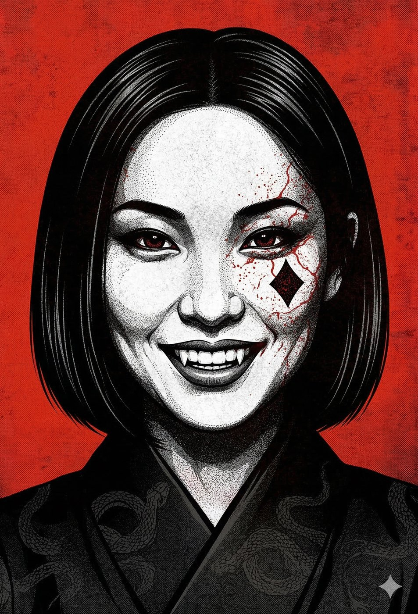
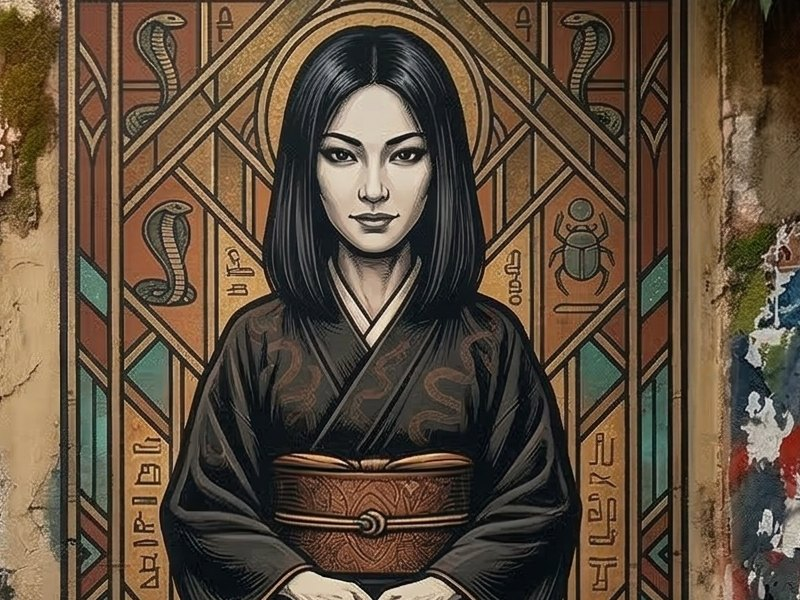
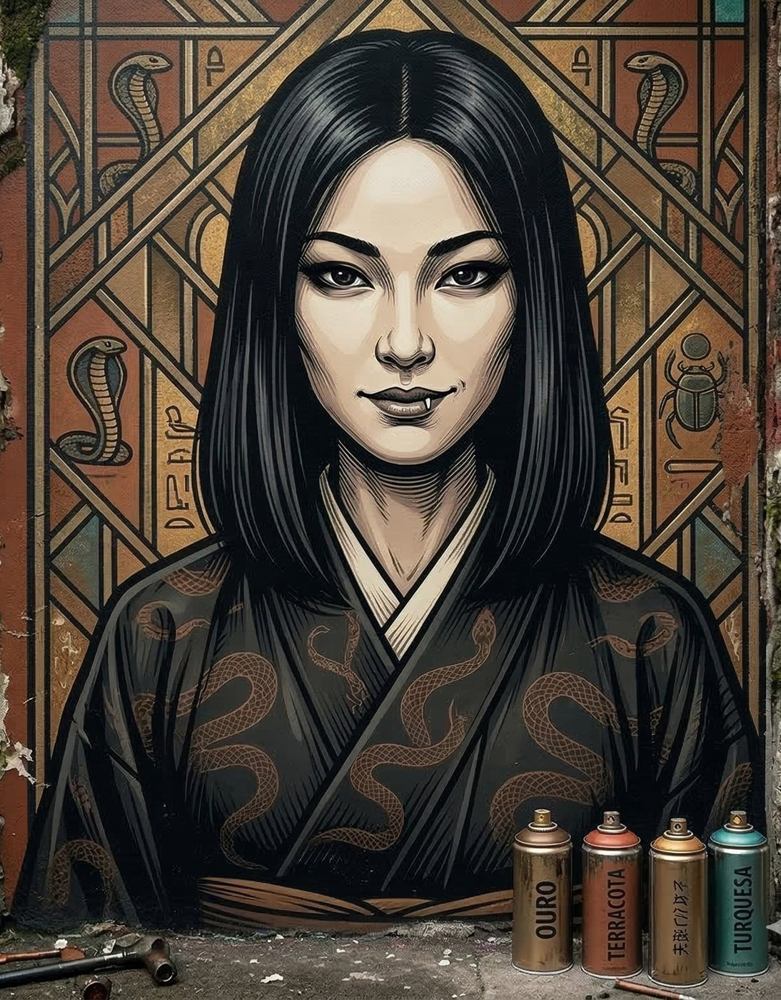
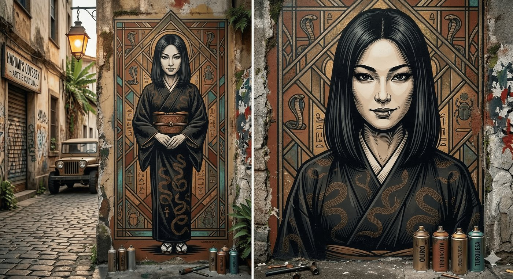

# Harumi — A Senhora das Correntes de Seda

**Facção:** Anarchs · **Clã:** Ministério · [Card no Trello](https://trello.com/c/XPQPxPEI)

**Veredito:** O Ministério (os antigos Seguidores de Set) passou por uma repaginada fantástica na V5. Eles não são mais apenas "cultistas egípcios de cobra"; eles são os mercadores da liberdade. Eles acreditam que a alma só atinge a iluminação quando se liberta das correntes da sociedade, da moralidade e da Camarilla. E a melhor forma de quebrar correntes é através do vício e do desejo.

Harumi é a personificação disso no bairro da Liberdade. Se o Guga te esmaga com uma marreta e o Vincenzo te apaga do mapa, a Harumi te serve um chá e faz você _pedir_ para colocar a coleira dela no próprio pescoço.

Aqui está a ficha da Aranha de Seda.

---

### **Harumi: A Senhora das Correntes de Seda**

- **Clã:** Ministério (Setita).
- **Idade:** ~90 anos (Aparenta ter 25. Abraçada nas décadas seguintes à imigração japonesa, em meio aos conflitos e à rigidez cultural de sua comunidade).
- **Posição:** Barão Independente (Liberdade & Aclimação).
- **Fachada:** Herdeira "fantasma" de um conglomerado que gerencia casas de chá exclusivas, karaokês VIP, spas de luxo e casas noturnas subterrâneas.
- **Realidade:** A maior traficante de "insumos" de São Paulo. Ela controla uma rede sofisticada de _Blood Dolls_ (humanos viciados no Beijo ou que oferecem sangue voluntariamente), narcóticos sintéticos de elite e extorsão. Ela descobre o desejo mais obscuro de um político, juiz mortal ou ancião da Camarilla, providencia esse desejo, e então é dona da pessoa para sempre.

#### **História Resumida**

Harumi cresceu sob o peso esmagador das expectativas culturais e do patriarcado. Quando um Mestre Setita a encontrou sufocando nessa gaiola de regras invisíveis, ele não a forçou a nada; ele apenas abriu a porta. Harumi abraçou a doutrina da "Libertação" do Ministério. Ela eliminou os antigos chefes da Yakuza local na década de 80 não com tiros, mas viciando seus filhos e generais. Hoje, ela governa a Liberdade com uma política de portas abertas. O BOES (Segunda Inquisição) tem extrema dificuldade de rastrear as operações dela porque tudo acontece a portas fechadas, com consentimento dos mortais. Suas vítimas não gritam por socorro; elas imploram por mais.

#### **Percepção dos Outros**

- **Isadora (Toreador):** "As festas da Harumi são um escândalo delicioso. O problema é que você entra achando que é o convidado de honra e sai de lá com uma dívida que o seu sangue não consegue pagar."
- **Coronel Machado (BOES):** "Um ponto cego tático. Ela não deixa corpos na rua, não causa pânico e a criminalidade no bairro dela é zero. O câncer perfeito, disfarçado de tecido saudável. Mas a hora dela vai chegar."
- **A Coterie:** "O paraíso envenenado. Ela é a única na cidade que tem sangue limpo suficiente para saciar a nossa fome sem disparar os radares do BOES. Mas o que ela vai pedir em troca?"

#### **O Gatilho da Tentação (Horror Hook para a Mesa)**

O horror da Harumi é a **Corrupção pelo Consentimento**. O Príncipe Dante obriga, o Guga ameaça, mas a Harumi _oferece_. Quando a Coterie chegar até ela com a Fome no Nível 4, rasgados e doendo pelas tatuagens, ela não vai interrogá-los. Ela vai oferecer taças de porcelana com _Vitae_ humana de altíssima qualidade, misturada com drogas anestésicas que apagam a dor dos chips. Ela oferece refúgio total. O preço? Apenas um "pequeno favor" moralmente repulsivo (ex: entregar o contato mortal de um deles para virar uma _Blood Doll_ do bordel dela). Se os jogadores aceitarem, eles salvam suas próprias vidas, mas destroem sua Humanidade.

---

### **Descrição Visual (Para ler na mesa)**

> "Vocês são guiados por becos cheios de letreiros em neon até os fundos de um restaurante na Liberdade. Uma porta blindada escondida atrás de engradados se abre para um mundo diferente: o barulho do trânsito some, substituído por um silêncio acústico perfeito e música ambiente suave. O cheiro não é de rua molhada, mas de incenso de flor de cerejeira e óleos essenciais caros.
>
> A sala é um oásis minimalista. Chão de tatame, divisórias de papel de arroz (shoji) e luzes indiretas quentes. Sentada de joelhos diante de uma mesa baixa de madeira escura está Harumi. Ela veste um quimono de seda preta com estampas muito sutis de serpentes se entrelaçando. Ela tem feições delicadas, cabelos perfeitamente lisos cortados na altura do queixo e uma postura de tranquilidade inabalável. Os olhos dela, escuros e profundos, parecem ler a dor e o desespero de vocês em um segundo. Ela não tem capangas brutamontes na sala, apenas duas mulheres e um homem mortais, incrivelmente bonitos, servindo chá com sorrisos vazios e apaixonados. Harumi sorri, mostrando uma leve ponta em suas presas, e fala com uma voz que soa como veludo: _'Pobres pássaros. Quebraram as asas batendo no vidro do Príncipe. Sentem-se. A gaiola ficou lá fora. Aqui, vocês podem finalmente respirar... e beber.'_"

---

### **Ficha Mecânica (V5 NPC - A Tentadora / Fixer)**

_(Para quando a Coterie tentar resistir à sedução dela, mentir ou se, por um milagre estúpido, tentarem atacá-la em seu santuário)_

- **Dificuldade Base:** 5 (Mentalmente e socialmente, ela é um buraco negro. Escapar da teia dela exige rolagens difíceis de Perseverança).
- **Paradas de Dados Padrão:** Físico 3, Mental 6, Social 8.
- **Atributos Secundários:** Vitalidade 6, Força de Vontade 8.
- **Paradas de Dados Excepcionais:** * _Persuasão / Subterfúgio (Sedução e Mentiras):_ 10 (Ela faz você acreditar que a ideia foi sua).
  - _Sagacidade (Insight - Ler os desejos):_ 9
  - _Furtividade (Ofuscação):_ 8
  - _Briga (Armas Brancas - Tanto/Kusarigama invisível):_ 6

**Equipamento Especial & Disciplinas:**

- **A Perdição do Ministério:** Harumi repudia a luz. Ela sofre penalidades maiores sob qualquer luz forte (mesmo artificial) e só opera na meia-luz suave.
- **Presença 4:** * _Fascínio (Awe) / Beijo Indelével (Lingering Kiss):_ O Beijo dela (ou de suas Blood Dolls preparadas) é o vício supremo. Mortais ou vampiros que beberem do sangue temperado dela ficam obcecados e farão qualquer coisa por outra dose. * _Invocação (Summon):_ Ela pode chamar mentalmente qualquer pessoa que tenha provado seu sangue.
- **Metamorfose 3:** * _Olhos da Besta (Eyes of the Beast) / O Olho da Serpente (Eyes of the Serpent - Poder Amalgamado com Presença):_ Se a diplomacia falhar, o olhar dela pode paralisar um vampiro no lugar, prendendo-o em um transe aterrorizante e submisso.
- **Ofuscação 3:** * _Manto de Sombras / Máscara de Mil Faces:_ Se o BOES bater na porta da frente, Harumi simplesmente entra na multidão de suas próprias festas e desaparece, ou assume o rosto de uma de suas funcionárias.
- **A Rede da Yakuza / Viciados (Recursos 5 / Aliados 4):** A segurança dela não é feita por seguranças de terno grosso, mas por mortais que dariam a vida por ela com um sorriso no rosto para ganhar a próxima "dose". Bater nela é bater em civis inocentes manipulados.

---

**Dica de Narrador:** Harumi é a "solução fácil" que custa muito caro. No **Capítulo 4**, se a Coterie não tiver poder de fogo para o BOES e nem poder político para o Príncipe Dante, eles podem rastejar até Harumi. Ela pode abrigá-los da Inquisição e fornecer sangue, mas em troca, ela fará a Coterie plantar provas na Faria Lima para derrubar Constance, abrindo espaço para a máfia do Ministério tomar o controle financeiro da cidade. Harumi não suja as mãos; ela terceiriza para personagens em desespero.

## Outras artes

---
_Texto e artes copiados do quadro Trello "Vampire - The Mascarade". Originais em alta resolução na pasta do projeto, em `trello/artes/originais/`._
