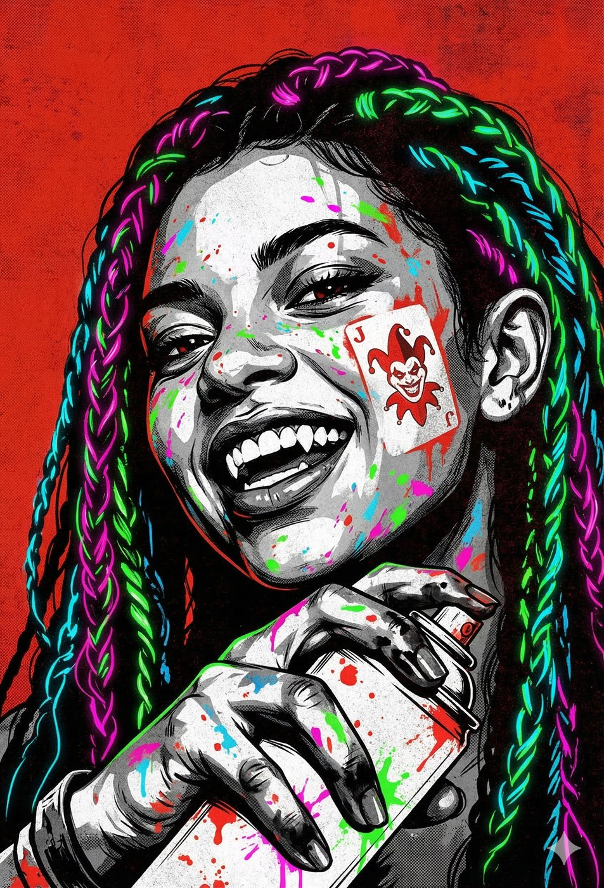
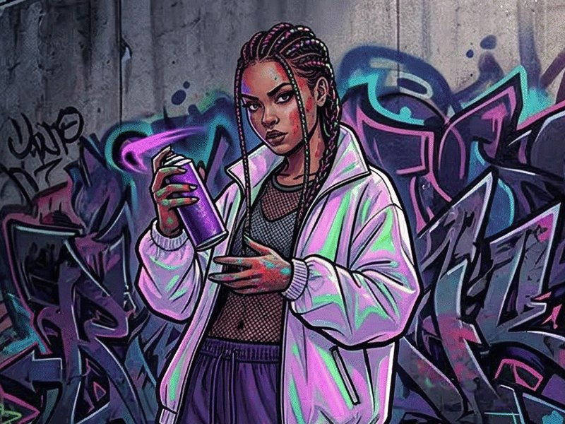
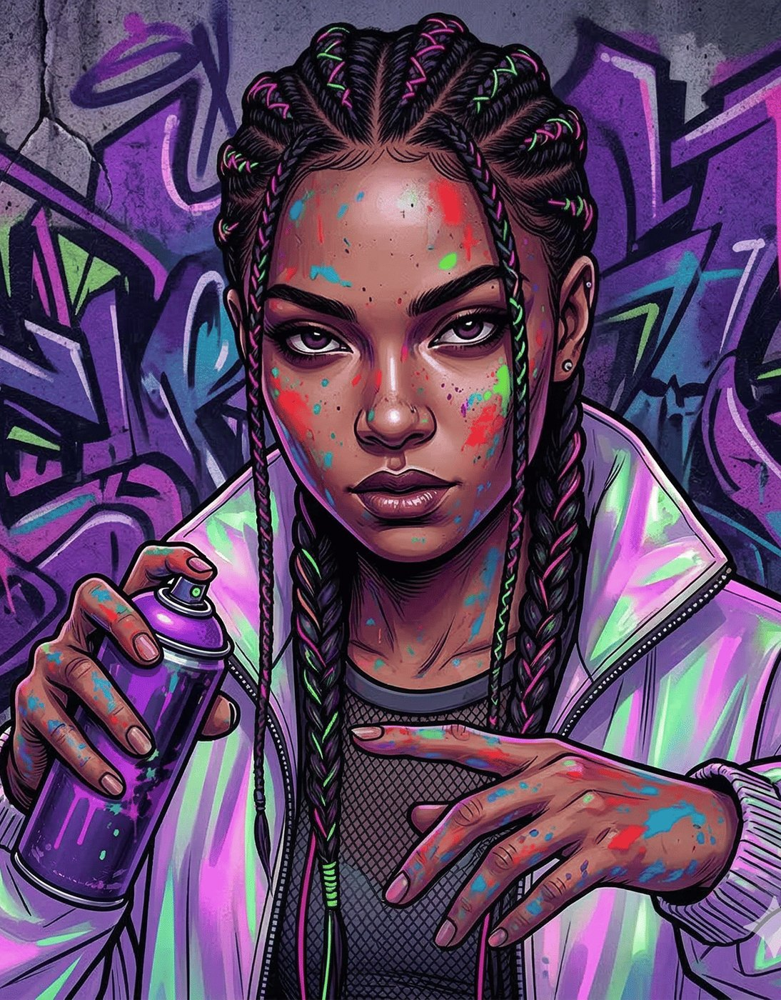
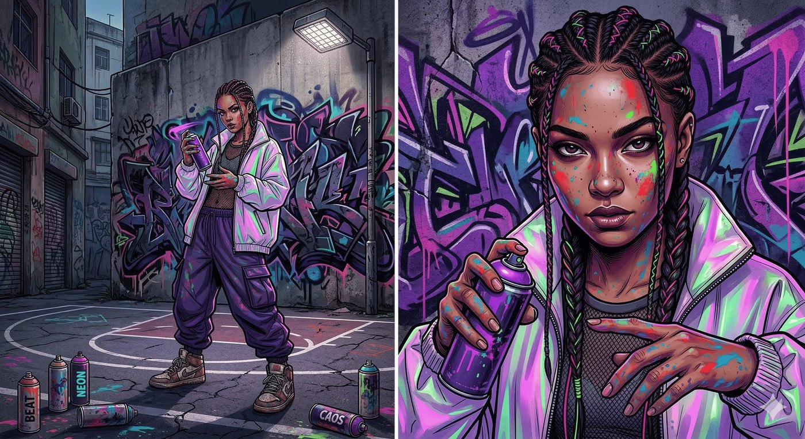

# Iara — A Arquiteta das Miragens

**Facção:** Anarchs · **Clã:** Ravnos · [Card no Trello](https://trello.com/c/kAr8OhBK)

**Crítica:** A Iara não é apenas mais uma Baronesa. Ela é a resposta da V5 ao mundo hiperconectado. Se a Dra. Elisa (da Inquisição) usa a tecnologia para rastrear o sangue, a Iara usa a tecnologia e a ilusão para **cegar** os inimigos. Em uma guerra de narrativas, a Iara é uma bomba atômica. Ela é a prova de que a Máscara da Camarilla está obsoleta.

Aqui está a ficha da voz das periferias, a Baronesa do Capão Redondo e Grajaú.

---

### **Iara: A Arquiteta das Miragens**

- **Clã:** Ravnos.
- **Idade:** ~50 anos (Aparenta ter pouco mais de 20. Abraçada nos anos 90, no auge da explosão do Hip Hop nacional e das batalhas de rima em São Paulo).
- **Posição:** Baronesa Anarquista da Zona Sul (Grajaú, Capão Redondo e adjacências).
- **Fachada:** Uma produtora cultural, grafiteira e organizadora de batalhas de slam e festivais de arte urbana na periferia.
- **Realidade:** A mestre da guerra assimétrica e da contra-informação. Ela usa a arte, as redes sociais e a Disciplina da ilusão (Quimerismo) para desviar a polícia de atividades dos Anarquistas, sabotar os negócios dos engravatados da Camarilla e criar "falsos positivos" que enlouquecem os drones do BOES.

#### **História Resumida**

Iara era uma artista de rua que pintava a realidade brutal da periferia nos muros cinzas de São Paulo. A arte dela tinha tanta vida e revolta que chamou a atenção de um Ravnos nômade. O Clã Ravnos quase foi extinto no final dos anos 90 (a Semana dos Pesadelos), o que os tornou sobreviventes paranoicos e nômades compulsivos. Iara herdou essa maldição. Ela nunca dorme no mesmo lugar duas noites seguidas. Essa constante movimentação a fez conhecer cada viela, laje e escadão da Zona Sul. Quando a Camarilla tentou "gentrificar" a área e colocar a polícia para limpar as ruas, Iara revidou. Ela não usou armas; ela usou vídeos virais forjados, ilusões projetadas de falsos tiroteios para afastar viaturas, e transformou a periferia em um labirinto onde a Torre de Marfim simplesmente se perde e vira piada na internet.

#### **Percepção dos Outros**

- **Isadora (Toreador):** "Arte? Pixação e rima barata não são arte. Ela é uma vândala digital que um dia vai quebrar a Máscara de uma forma tão espetacular que todos nós vamos queimar juntos."
- **Coronel Machado (BOES):** "O alvo mais frustrante. Mandamos uma equipe tática para um galpão com base em uma denúncia de 'culto satânico' vazada na internet, e quando chegamos lá, era só um holograma distorcido e um paredão de som tocando funk no talo. Ela zomba do fardamento."
- **A Coterie:** "A saída de emergência virtual. Se precisarmos que o mundo olhe para o lado esquerdo enquanto fugimos pela direita, a Iara é a única capaz de criar o show pirotécnico perfeito."

#### **O Gatilho da Realidade Editada (Horror Hook para a Mesa)**

O horror da Iara é a **Incerteza Absoluta (Gaslighting místico)**. A magia dos Ravnos mexe com os sentidos. Se a Coterie for ao território dela e tentar ameaçá-la, a Iara não saca uma arma. De repente, a Coterie ouve as sirenes do BOES se aproximando. Eles veem os feixes de luz ultravioleta das armas subindo a escada. Eles sentem o cheiro de fósforo branco. Eles entram em pânico e fogem... apenas para perceberem, quarteirões depois, que não havia polícia nenhuma. Era só a Iara brincando com o cérebro deles para expulsá-los do quintal dela sem sujar as mãos.

---

### **Descrição Visual (Para ler na mesa)**

> "O endereço leva vocês a uma quadra poliesportiva coberta no meio do Capão Redondo. Está rolando uma batalha de rima. O som do beat bate pesado no peito de vocês, e o cheiro de spray de tinta fresca e maconha domina o ar. A energia do lugar é elétrica, caótica e viva.
>
> Vocês encontram Iara encostada em uma parede de tijolo aparente, finalizando um grafite imenso sob a luz de refletores de LED coloridos. Ela veste calças largas de tactel, um top escuro, e uma jaqueta corta-vento reflexiva. Os cabelos são trançados com linhas neon, e ela tem o rosto e as mãos salpicados de tinta. Ela se move o tempo todo: balança a cabeça no ritmo da música, gira a lata de spray nos dedos, inquieta. Por causa da Maldição Ravnos, ela exala uma energia de quem está sempre pronta para correr. Quando ela percebe vocês, a música na quadra parece baixar de volume só para vocês, e as sombras do grafite na parede parecem se contorcer por um segundo. Ela sorri, joga a lata de spray para o ar e diz: _'O GPS de vocês quebrou, filhotes de Faria Lima? Cuidado por onde andam. A realidade por aqui depende do ângulo que você olha... e da música que tá tocando.'_"

---

### **Ficha Mecânica (V5 NPC - A Trapaceira / Ilusionista)**

_(Para quando a Coterie precisar lidar com as ilusões dela, tentar rastreá-la ou contratá-la para uma distração em massa)_

- **Dificuldade Base:** 4 (Para ataques físicos). Dificuldade 6+ (Para tentar encontrá-la, segui-la ou distinguir o que é real perto dela).
- **Paradas de Dados Padrão:** Físico 4, Mental 6, Social 7.
- **Atributos Secundários:** Vitalidade 6, Força de Vontade 7.
- **Paradas de Dados Excepcionais:** * _Subterfúgio / Persuasão (Atuação e Ilusão):_ 9 (Ela mente com o corpo, a voz e a mente).
  - _Manha / Furtividade (Sobrevivência Urbana):_ 8
  - _Tecnologia (Redes Sociais / Edição de Vídeo):_ 8
  - _Atletismo (Parkour / Fuga):_ 7

**Equipamento Especial & Disciplinas:**

- **A Perdição Ravnos (Doom):** Ela queima (Dano Agravado automático) se dormir no mesmo lugar físico mais de uma vez em um período de sete noites. Ela é o epítome do movimento constante.
- **Ofuscação 3 & Presença 2 (Quimerismo - Amálgama):** * _Fata Morgana:_ Ela pode criar ilusões perfeitas de qualquer coisa (um esquadrão da polícia, um incêndio, uma parede onde há uma porta) que enganam todos os sentidos, inclusive de câmeras, durante o tempo em que ela se concentrar.
  - _Ignis Fatuus:_ Pequenas ilusões e distrações sensoriais (o som de um tiro, o cheiro de gás vazando) para causar pânico.
  - _Manto de Sombras / Máscara de Mil Faces:_ Como todo bom trickster, se as coisas derem errado, ela simplesmente vira outra pessoa e sai andando pela porta da frente.
- **Animalismo 2:** * _Sentir a Besta / Sussurros Selvagens:_ Ela usa os pombos, ratos e vira-latas da Zona Sul como uma rede de vigilância viva para saber quando os engravatados ou o BOES estão entrando na área.
- **O Exército Digital (Aliados/Influência):** Iara pode acionar milhares de seguidores mortais no Instagram, TikTok e grupos de WhatsApp para realizar um "Flash Mob", fechar uma rua, ou viralizar uma mentira que afaste a polícia de um local.

---

**Dica de Narrador:** No Capítulo 4, se os jogadores precisarem invadir um local altamente protegido (como a base do BOES ou a capela da Luciana), eles podem não ter poder de fogo para entrar atirando, nem furtividade para entrar escondidos. Mas eles podem contratar a Iara. A Iara pode forjar uma "ameaça terrorista" ou uma "quebra de Máscara escandalosa" do outro lado da cidade, fazendo o BOES ou o Xerife correrem para lá, deixando o caminho livre para a Coterie. O preço dela? A Coterie vai ter que ajudá-la a humilhar a Camarilla publicamente de alguma forma.

## Outras artes

---
_Texto e artes copiados do quadro Trello "Vampire - The Mascarade". Originais em alta resolução na pasta do projeto, em `trello/artes/originais/`._
