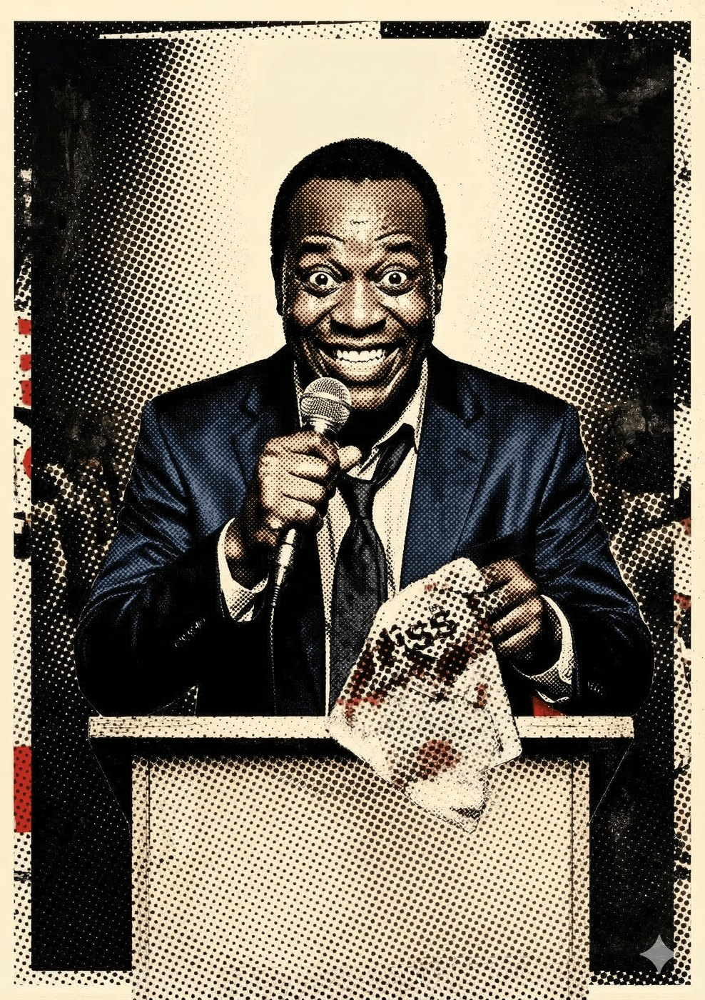

# Irmão Silas — O Pastor da Loucura

**Facção:** Secundários · **Clã:** Malkaviano · [Card no Trello](https://trello.com/c/hX20W8qM)

#### **Irmão Silas (Malkaviano) - O Pastor da Loucura**

- **Função:** Líder Neopentecostal na Zona Leste; usa a fé para esconder o Frenesi e se alimentar.
- **Paradas Excepcionais:** Liderança 8, Performance (Pregação) 8, Intimidação 6. (Físico fraco: 3).
- **Disciplinas-Chave:** _Dominação 3_ (Dementação - enlouquece multidões), _Auspícios 2_.
- **O Truque:** Ele não briga. Ele faz a igreja inteira (50+ mortais) entrar em transe histérico e atacar a Coterie achando que são demônios, enquanto ele foge pelos fundos.

---
_Texto e artes copiados do quadro Trello "Vampire - The Mascarade". Originais em alta resolução na pasta do projeto, em `trello/artes/originais/`._
