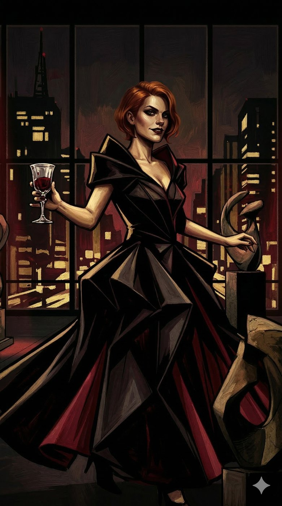
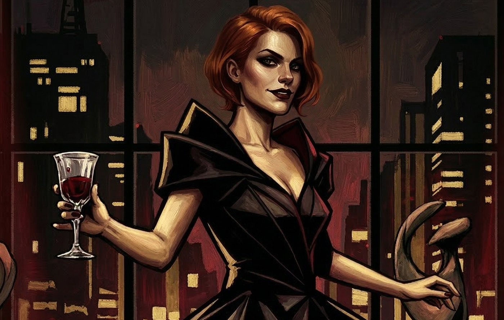
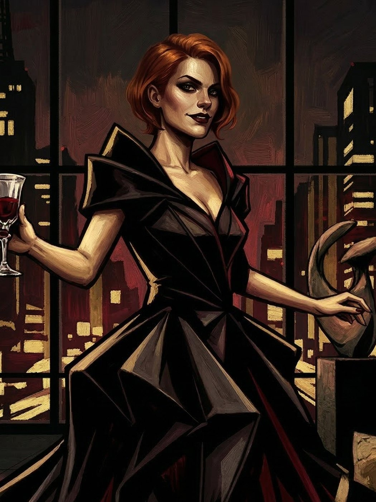

# Isadora — A Musa de Sangue e Arte

**Facção:** Camarilla · **Clã:** Toreador · [Card no Trello](https://trello.com/c/8A1u6Ghi)

**Veredito:** Isadora é o veneno adoçado da sua crônica. Em uma cidade brutal como São Paulo, a Toreador que controla os Elísios (locais de trégua) é essencial. Dante a usa como sua "Relações Públicas", mas o horror nela não é a política; é a **Fome Insaciável**. Com Humanidade baixa (4), ela está a um passo de se tornar uma aberração. Ela não vê os humanos como pessoas, mas como "obras de arte" ou "suco de uva" com pernas. Ela é a prova de que a beleza na V5 é uma máscara para um monstro faminto.

Aqui está a ficha da sua Arauto.

---

### **Isadora: A Musa de Sangue e Arte**

- **Clã:** Toreador (10ª Geração).
- **Idade:** ~120 anos (Aparenta ter 28. Abraçada em 1905, durante a _Belle Époque_ paulista).
- **Posição:** Arauto de São Paulo e Guardiã do Elísio (MASP/Museu do Ipiranga).
- **Atributos de Destaque:** Charisma 5 (Beleza hipnótica), Manipulação 4 (Politicagem social), Compostura 4 (Fachada inabalável).
- **Disciplinas:** Presença 4 (Awe, Entrancement, Summon - para controlar a Corte), Auspícios 3 (Para ler as intenções e fraquezas dos rivais), Celeridade 2 (Graça e movimento sobrenatural).
- **Predição (Bane):** _Obsessão pela Beleza_. Se Isadora não estiver cercada por algo verdadeiramente belo (arte, arquitetura ou um sangue raro), ela sofre penalidades drásticas em todas as suas ações. _Compulsão:_ _Encanto_. Isadora é compelida a fazer com que a Coterie (ou qualquer um) a adore intensamente, muitas vezes através de bajulação predatória ou hospitalidade avassaladora que mascara sua periculosidade.
- **Humanidade:** 4 (Ela está deslizando para a Besta. Ela é cruel, vazia e vê os mortais como ferramentas descartáveis).

#### **História Resumida**

Filha de um barão do café, Isadora foi abraçada por um Toreador europeu que visitava o Brasil, não por seu talento artístico (ela não tem nenhum), mas por ser _a_ obra de arte viva de sua geração. Ela sobreviveu às décadas transformando-se na _gatekeeper_ da alta sociedade. Dante a usa para controlar a narrativa social e para encobrir os sumiços de corpos que o Xerife não consegue resolver. O horror é que Isadora não apenas se alimenta; ela "cria". Ela mantém "coleções" de humanos de rara beleza em seu refúgio, alimentando-se deles de forma tática para mantê-los vivos, mas quebrados, como "instalações artísticas" temporárias.

#### **Percepção dos Outros**

- **Dante (Príncipe):** "Um terno bem cortado que sabe dançar conforme a música. Ele me dá os melhores museus; eu lhe dou a adoração dos mortais influentes. É uma troca justa, contanto que ele não olhe muito de perto para os meus desperdícios."
- **Luciana (Senescal):** "Tão... utilitária. Ela cheira a mofo de livro e feitiçaria antiga. Útil, suponho, mas desprovida de paixão. Meus segredos estão seguros com ela, pois ela gosta de segredos mais do que de arte."
- **Cão (Xerife):** "Uma abominação necessária. O contraste perfeito para minha beleza. Eu finjo que ele não existe, e ele finge que não vê quem entra no meu refúgio e nunca sai."
- **A Coterie (Jogadores):** "Peças de xadrez em branco. Interessantes em sua confusão. Eu sinto o cheiro do medo neles, e isso me dá fome. Se eles forem úteis para o Príncipe, ótimo. Se não... talvez eles sirvam como 'instalações artísticas' temporárias no meu próximo evento."

#### **Refino e Melhoria (V5 Horror Hook)**

Para aprofundar o horror pessoal, a Coterie pode descobrir um de seus "ateliês" escondidos abaixo do MASP enquanto investiga outra coisa. O horror não é a fome, é a crueldade estética. Eles encontrarão um mortal, outrora um modelo famoso, agora um "Sculptor of Flesh" (Fleshcrafted) — não pelo clã Tzimisce, mas por Isadora ter "moldado" o corpo dele com cirurgias e abusos para que ele sirva como um "recipiente de sangue" que ela acha visualmente agradável. Isso mostra o nível de psicopatia que a imortalidade e a baixa humanidade trazem.

---

### **Descrição Visual para a Imagem**

Isadora aparenta ter 28 anos. É deslumbrantemente bela, mas uma beleza que evoca o "Uncanny Valley" devido à sua baixa Humanidade — seus olhos são grandes demais, sua pele perfeita demais. Ela veste um vestido de gala preto de alta costura, com elementos escultóricos dramáticos que sugerem vinho tinto ou sangue derramado. Suas joias são minimalistas, mas valem milhões. Ela está na galeria principal do MASP (Museu de Arte de São Paulo) à noite, durante um evento exclusivo "fechado" para a Camarilla. Ela segura uma taça de cristal com um líquido vermelho escuro e denso (Vitae). Ao fundo, esculturas dinâmicas são iluminadas por holofotes vermelhos, projetando sombras ameaçadoras nas paredes de vidro que revelam o horizonte caótico da Avenida Paulista. A atmosfera é "Gothic-Punk" luxuosa e perigosa.

## Outras artes

---
_Texto e artes copiados do quadro Trello "Vampire - The Mascarade". Originais em alta resolução na pasta do projeto, em `trello/artes/originais/`._
