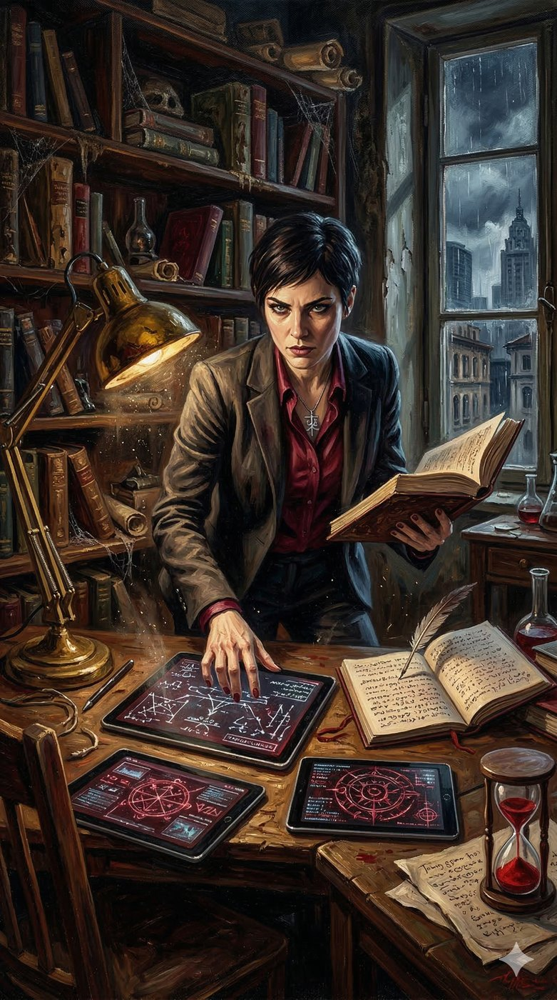
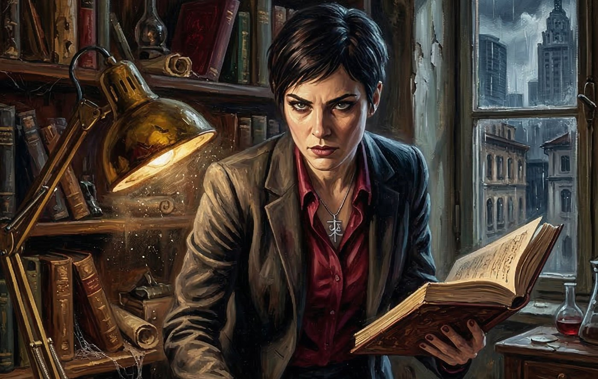
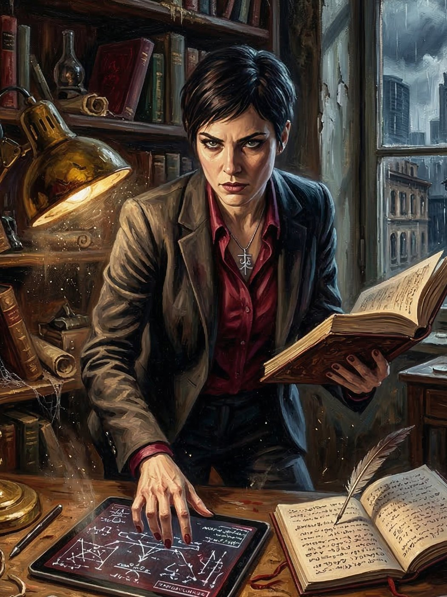

# Luciana — A Arquitetura do Esquecimento

**Facção:** Camarilla · **Clã:** Tremere · [Card no Trello](https://trello.com/c/qmVs2oEm)

**Veredito:** Luciana é o cérebro que mantém a praxis de Dante funcional. Sem ela, o Príncipe Ventrue já teria sido desmascarado pelo BOES (SI) ou destronado pela Lasombra Constance. Ela é a arquiteta da "nova Máscara" mística em São Paulo e, crucialmente, é a responsável direta pela amnésia da sua Coterie.

Aqui está a ficha da sua Senescal.

---

### **Luciana: A Arquitetura do Esquecimento**

- **Clã:** Tremere (9ª Geração).
- **Idade:** ~90 anos (Aparenta 35. Abraçada em meados do século XX).
- **Posição:** Senescal e Regente da Capela local.
- **Atributos de Destaque:** Inteligência 5 (Técnica e Lógica), Manipulação 4 (Política de Sangue), Raciocínio 4 (Tática).
- **Disciplinas:** Feitiçaria de Sangue (Blood Sorcery) 4, Dominação 4, Auspícios 3.
- **Predição (Bane):** Tremere Bane (V5): _Deficiência_. O sangue de Luciana é fraco para Laços de Sangue (Blood Bonds) e para criar Carniçais (Ghouls). Exige mais sangue e é menos potente. _Compulsão:_ Perfeccionismo. Se ela não executar uma tarefa mística ou burocrática perfeitamente, ela sofre penalidades até que o erro seja corrigido.

#### **História Resumida**

Abraçada na Europa do pós-guerra, Luciana foi criada no rigor da Pirâmide. Ela é uma sobrevivente do ataque da SI à Capela Central em Viena em 2008. Esse trauma a definiu. Ela não é leal a Dante por ideologia, mas por pragmatismo: ele oferece os recursos financeiros e a proteção política que ela precisa para reconstruir sua Capela em São Paulo e encontrar uma contramedida mística contra a tecnologia de detecção térmica da SI.

#### **Percepção dos Outros**

- **Dante (Príncipe):** "Um Ventrue previsível. Ele acha que comanda o jogo, mas eu comando as regras. Preciso dele como escudo enquanto reergue minha Capela nas sombras de São Paulo."
- **Constance (Lasombra):** "Pulsante. Perigosa. Seus movimentos financeiros na periferia estão começando a interferir nos meus próprios rituais de ocultação. Estamos em rota de colisão."
- **A Coterie (Jogadores):** "Meus 'pacientes'. A Dominação funcionou bem demais. Estou monitorando os níveis de sangue deles. Se os fragmentos de memória voltarem de forma violenta, terei que esterilizá-los (Morte Final) para não vazar o segredo do Príncipe."

#### **Refino e Melhoria (V5 Hook)**

Luciana está testando uma nova forma de Feitiçaria de Sangue em São Paulo, usando o sangue dos Anarquistas capturados. O objetivo dela é criar um ritual que "congele" a temperatura corporal dos vampiros para torná-los invisíveis aos drones térmicos da SI (BOES). Ela precisa de cobaias. Se a Coterie falhar na missão do porto e confessar a amnésia, eles serão os próximos "pacientes" em sua mesa de operações.

---

### **Descrição Visual para a Imagem**

Luciana aparenta ter 35 anos. Aparência europeia, severa e analítica. Cabelos curtos, escuros e práticos (não o estilo esvoaçante Toreador). Ela veste um blazer de sarja cinza chumbo sobre uma camisa de seda burgundy, com um pingente de prata sutil que sugere um símbolo hermético Tremere. Seu olhar é direto, frio e intimidador.

## Outras artes

---
_Texto e artes copiados do quadro Trello "Vampire - The Mascarade". Originais em alta resolução na pasta do projeto, em `trello/artes/originais/`._
