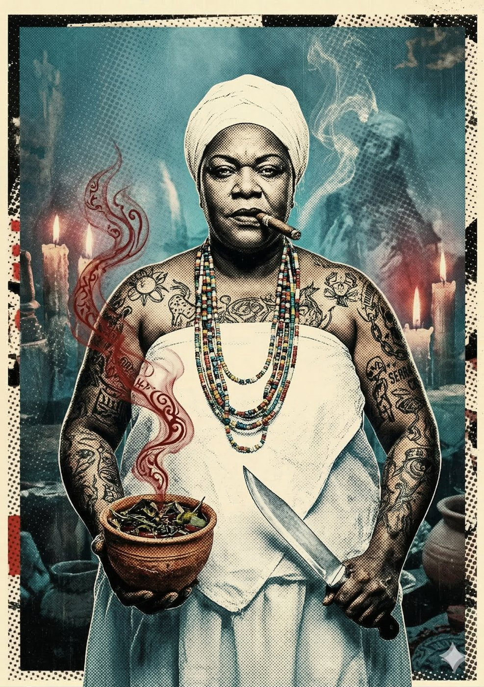

# Mãe Silvia — A Consultora da Cura

**Facção:** Secundários · **Clã:** Tremere · [Card no Trello](https://trello.com/c/zNnoAXUK)

#### **Mãe Silvia (Tremere) - A Consultora da Cura**

- **Função:** Dona de terreiro em Interlagos (fachada). A médica clandestina da sociedade vampírica.
- **Paradas Excepcionais:** Ocultismo (Ervas/Magia) 8, Medicina 7, Empatia 7.
- **Disciplinas-Chave:** _Feitiçaria de Sangue 3_ (Rituais de Cura/Proteção), _Auspícios 2_.
- **O Truque:** As queimaduras químicas do Coronel Machado ou da Tatuagem UV não curam sozinhas. A Mãe Silvia faz cataplasmas de cinzas e Vitae que estancam a dor, mas exigem que a Coterie participe de seus rituais estranhos.

---
_Texto e artes copiados do quadro Trello "Vampire - The Mascarade". Originais em alta resolução na pasta do projeto, em `trello/artes/originais/`._
