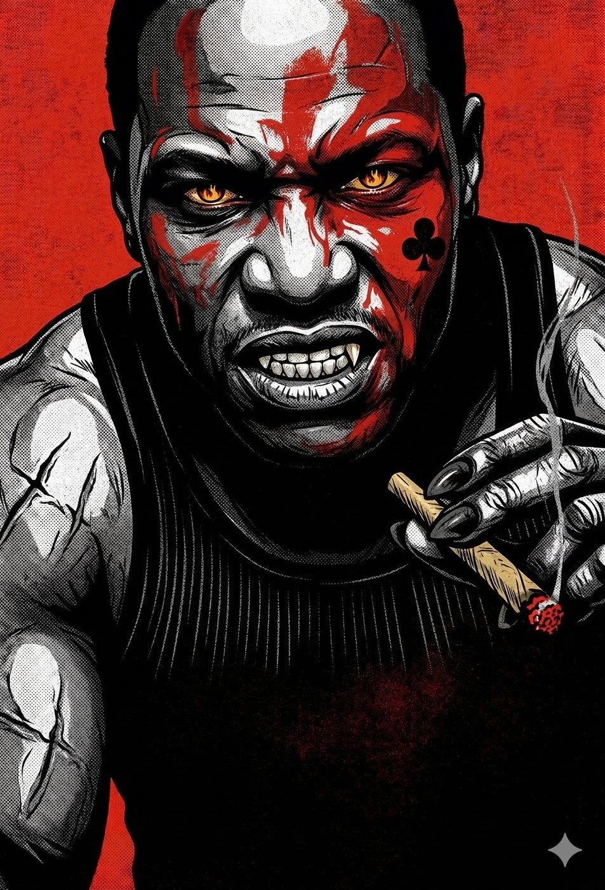
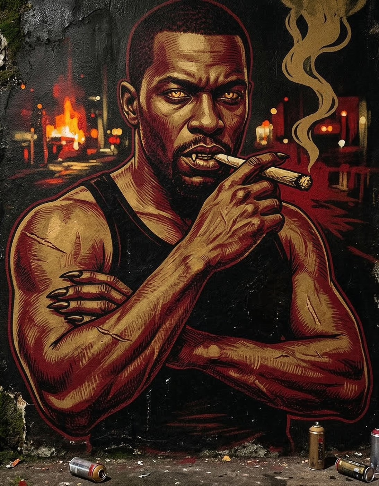
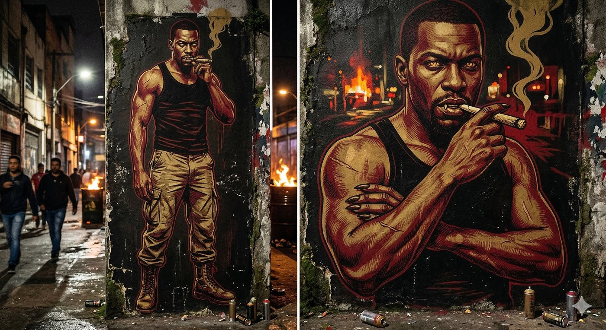
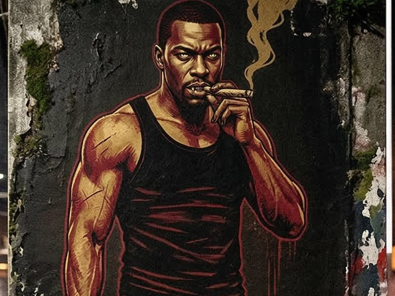

# Nego — O Rei de Espadas do Asfalto

**Facção:** Anarchs · **Clã:** Gangrel · [Card no Trello](https://trello.com/c/2i0kCdL8)

**Veredito:** O Nego é o coração pulsante e furioso da rua. Na V5, os Gangrel saíram da Camarilla e abraçaram a causa Anarquista ou Independente. O Nego não é um ativista de palanque; ele é um senhor da guerra urbano. A Cracolândia e as ocupações do Centro são o castelo dele, e os esquecidos pela sociedade são o seu fosso e suas muralhas.

Se a Constance (Lasombra) é o horror do capitalismo predatório que expulsa os pobres, o Nego é o horror da miséria transformada em arma. Ele protege os seus, mas o preço é a lealdade cega.

Aqui está a ficha do Senhor da Guerra do Centro Velho.

---

### **Nego: O Rei de Espadas do Asfalto**

- **Clã:** Gangrel.
- **Idade:** ~70 anos (Aparenta ter do final dos 30 aos 40. Abraçado nos anos 70, durante a explosão do inchaço urbano e da marginalização no Centro).
- **Posição:** Barão Anarquista do Centro (Ocupações / Sé / Cracolândia).
- **Fachada:** Um "protetor" e organizador de movimentos de moradia. Aquele que dá teto aos Sangues-Ralos e aos vampiros que fugiram do Sabá e não têm para onde ir.
- **Realidade:** Um tirano pragmático. Ele monopolizou o fluxo de drogas e a massa de dependentes químicos da Cracolândia. Os mortais ali são seu rebanho intocável, e a paranoia constante deles serve como o melhor sistema de alarme contra a polícia, a Inquisição e a Camarilla.

#### **História Resumida**

Nego era um sobrevivente. Antes do Abraço, era segurança de bicheiro; depois, virou o cão de guarda de um bando do Sabá que operava na Boca do Lixo. Quando a Guerra da Gehenna chamou os anciões do Sabá para o Oriente Médio, Nego viu a loucura suicida daquilo e desertou, ficando em São Paulo. Ele juntou os órfãos do Sabá e os Sangues-Ralos descartados pela Camarilla e montou um exército. Quando o BOES começou a limpar a cidade, Nego percebeu que a Inquisição rastreava o calor e o padrão de vida. Então, ele se enfiou onde o caos térmico e social é absoluto: a Cracolândia. É impossível para um drone do BOES distinguir a assinatura térmica de um vampiro frio no meio de mil corpos amontoados, fogueiras em latões e barracas de lona. Ele construiu uma fortaleza de carne humana miserável.

#### **Percepção dos Outros**

- **Constance (Lasombra):** "A madame acha que pode comprar meu chão com dinheiro de banco suíço e trator da prefeitura. Ela manda a PM pra me despejar de dia; eu mando os meus rasgarem a garganta dos capatazes dela à noite."
- **Coronel Machado (BOES):** "Os fardados não entram aqui. O meu exército não tem medo de tiro de borracha, e o calor das fogueiras cega os óculos caros deles."
- **A Coterie:** "Cachorrinhos de madame de coleira nova. Vieram ganindo pro meu território achando que a rua é bagunça. Se quiserem respirar o meu ar, vão ter que sangrar pela matilha."

#### **O Gatilho Animal (Horror Hook para a Mesa)**

O horror do Nego é a **Simbiose Parasitária**. Ele protege os moradores de rua e os viciados, mas ele _os consome_. Ele usa _Animalismo_ para comandar não apenas os ratos e cães vadios do centro, mas também para incitar a turba humana. Se a Coterie for ao território dele exigir algo ou agir com arrogância, Nego não precisa levantar um dedo; uma multidão de cinquenta dependentes químicos armados com pedaços de pau, facões e pedras os cerca, com os olhos vidrados pela Fome transferida do Barão.

---

### **Descrição Visual (Para ler na mesa)**

> "O Nego não recebe vocês em um escritório; ele recebe vocês no telhado de um prédio ocupado de 15 andares, sem luz elétrica, com vista para a fogueira coletiva da Cracolândia lá embaixo. Ele é um homem negro, alto, com ombros largos como a porta de um cofre. Ele não usa terno, veste uma calça cargo militar desbotada, coturnos pesados e uma regata preta justa que não esconde a musculatura tensa nem as cicatrizes de faca nos braços.
>
> Por causa da Maldição dos Gangrel (Perdição de Clã), as feições dele já perderam um pouco da humanidade. Os olhos dele brilham no escuro com um tom amarelado de lobo, refletindo as chamas da rua. Os dentes são ligeiramente pontiagudos mesmo quando ele não está mostrando as presas, e as unhas das mãos são grossas e escuras como garras curtas. Ele fuma um cigarro de palha grosso. Ao redor dele, três cães de rua imensos e cheios de cicatrizes rosnam baixinho, sincronizados com a respiração dele. Ele olha para os ternos caros de vocês, cospe no chão de cimento e diz, com uma voz que parece um rosnado de motor: _'Espero que o sapato de vocês corra rápido, playboys. Porque o cheiro que vocês trouxeram atrai chumbo.'_"

---

### **Ficha Mecânica (V5 NPC - Barão Warlord)**

_(Para quando a diplomacia falhar ou se ele lutar ao lado da Coterie contra a SI)_

- **Dificuldade Base:** 5 (Ele é um alfa territorial. Bater de frente com ele no Centro é quase suicídio).
- **Paradas de Dados Padrão:** Físico 7, Mental 4, Social 5.
- **Atributos Secundários:** Vitalidade 9 (Um tanque de guerra), Força de Vontade 7.
- **Paradas de Dados Excepcionais:** * _Briga (Corpo a Corpo / Garras Ferais):_ 9
  - _Sobrevivência (Urbana):_ 8
  - _Liderança (Matilha / Turba):_ 7
  - _Manha (Conhecimento do Centro):_ 8
  - _Empatia com Animais:_ 7

**Equipamento Especial & Disciplinas:**

- **Proteanismo 4:** * _Garras da Besta (Feral Weapons):_ Em combate, os dedos dele viram garras negras que causam **Dano Agravado automático** (não mitigado por coletes da SI).
  - _Metamorfose (Shapechange):_ Ele pode virar um cão de rua monstruoso ou um morcego para fugir.
  - _Fusão com a Terra (Earth Meld):_ Se a SI cercar o prédio de dia, ele afunda no concreto quebrado ou no asfalto e desaparece.
- **Fortitude 3:** * _Resiliência / Tenacidade:_ Subtrai o dano recebido. Ele é o cara que toma um tiro de escopeta da Inquisição no peito, ri, arranca o estilhaço e continua andando.
- **Animalismo 3:** * _Sentir a Besta / Subjugar a Besta:_ Nego sabe exatamente o quão faminta a Coterie está assim que eles pisam no prédio dele. Ele também pode acalmar o frenesi de um jogador ou jogar a própria Besta dele na turba, incitando um motim.
- **O Exército dos Ralos:** A qualquer momento em seu território, Nego tem pelo menos meia dúzia de Sangues-Ralos ou capangas humanos (como o **Rato**) dispostos a morrer por ele.

---

**Dica de Narrador:** O Nego não gosta da Coterie. A Camarilla é inimiga. Mas ele odeia o BOES e a Lasombra muito mais. O Capítulo 3 pode terminar com a Coterie sendo julgada por ele. Se eles convencerem o Nego de que o Príncipe Dante e a Inquisição armaram para eles, Nego pode se tornar o exército que a Coterie precisa para invadir a Faria Lima ou o Porto. Mas o preço dele será o controle absoluto do Centro.

## Outras artes

---
_Texto e artes copiados do quadro Trello "Vampire - The Mascarade". Originais em alta resolução na pasta do projeto, em `trello/artes/originais/`._
