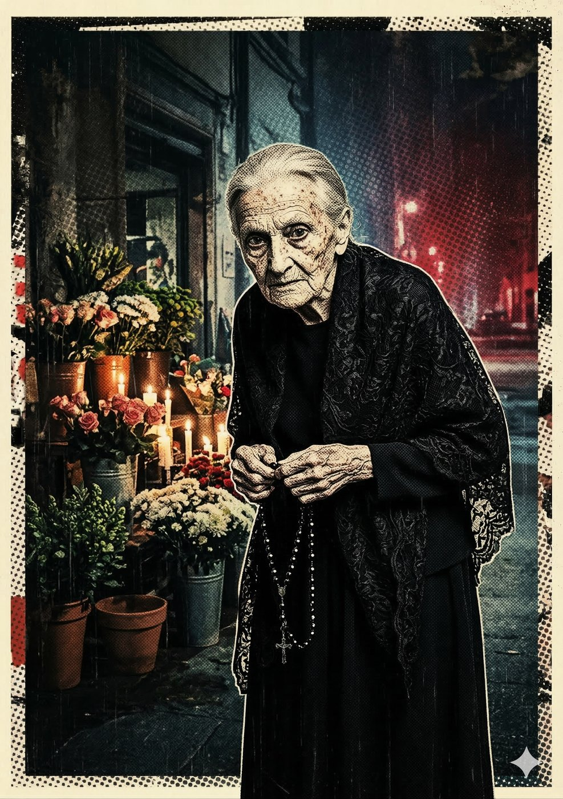

# Nonna Benedetta — A Zeladora dos Mortos

**Facção:** Secundários · **Clã:** Hecata · [Card no Trello](https://trello.com/c/IPPO5GEV)

#### **Nonna Benedetta (Hecata) - A Zeladora dos Mortos**

- **Função:** Velhinha da floricultura da Consolação. Vende informações sussurradas por fantasmas.
- **Paradas Excepcionais:** Ocultismo (Necromancia) 8, Sagacidade (Empatia) 7, Tradições/História 7.
- **Disciplinas-Chave:** _Oblivion 3_ (Cerimônias Necromânticas), _Auspícios 2_.
- **O Truque:** Se a Coterie matar alguém sem querer e precisar saber se a Inquisição achou o corpo, a Nonna invoca o fantasma da vítima para "perguntar". O preço é sempre uma antiguidade ou um dente do vampiro.

---
_Texto e artes copiados do quadro Trello "Vampire - The Mascarade". Originais em alta resolução na pasta do projeto, em `trello/artes/originais/`._
