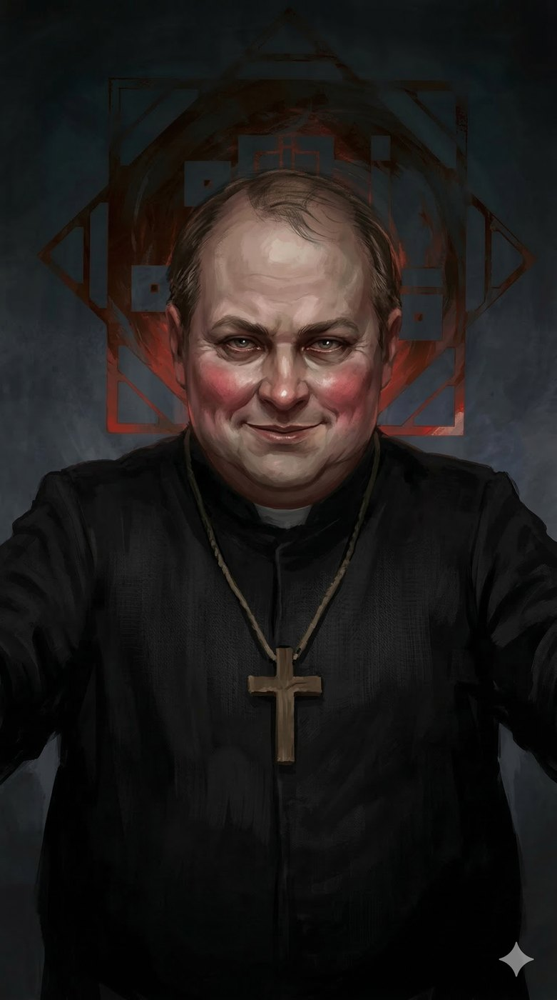
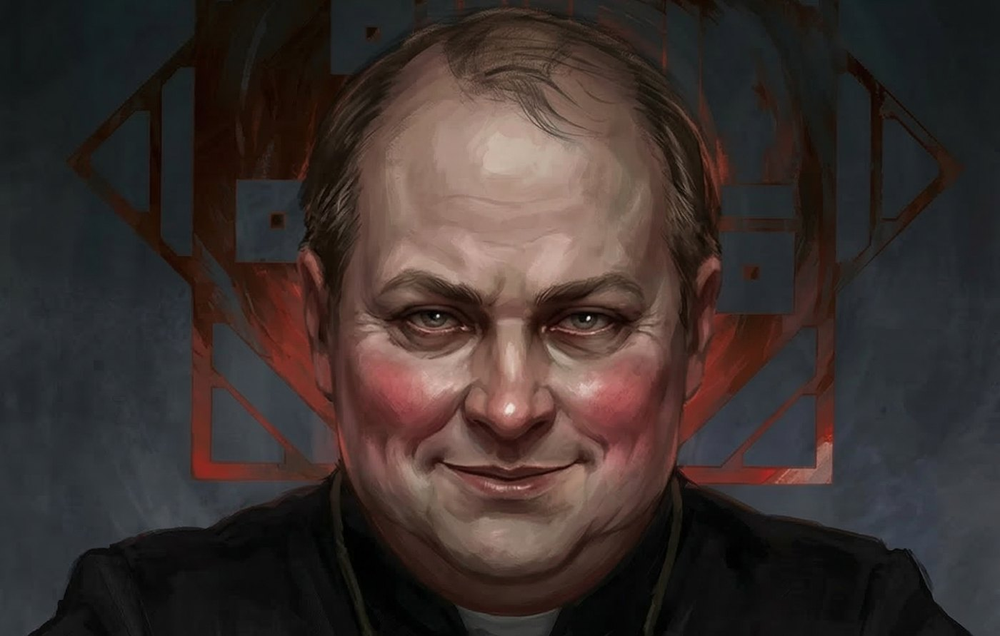
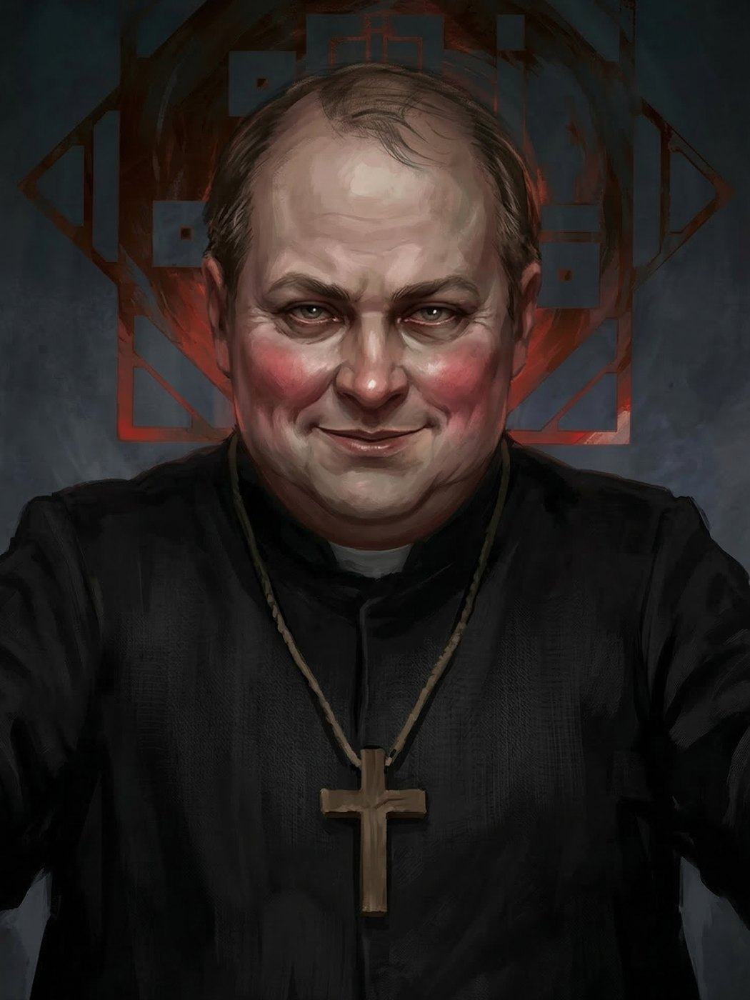

# Padre Bernardo — O Pastor das Sombras Amigáveis

**Facção:** Camarilla · **Clã:** Malkaviano · [Card no Trello](https://trello.com/c/3UzOuD7l)

**Veredito:** Excelente ajuste. Transformar o Malkaviano em um "bonachão" gordinho é um tropo clássico de horror: o perigo disfarçado de conforto. Um padre que parece aquele tio legal que te oferece um biscoito, mas que, enquanto sorri, está descrevendo detalhadamente a cor do seu sangue quando você finalmente encontrar a Morte Final. Isso o torna muito mais insidioso que o estereótipo do "louco sujo e magro".

Aqui está a ficha atualizada para o **Padre Bernardo**.

---

### **Padre Bernardo: O Pastor das Sombras Amigáveis**

- **Clã:** Malkaviano (9ª Geração).
- **Idade:** ~140 anos (Aparenta ter 50. Abraçado em 1886).
- **Posição:** Primogênito dos Malkavianos.
- **Atributos de Destaque:** Raciocínio (Wits) 5, Perseverança (Resolve) 4, Empatia (Insight) 5 (Aumentada pela sua natureza acolhedora).
- **Disciplinas:** Auspícios 4, Dominação 3 (Dementação), Ofuscação 2.
- **Predição (Bane):** _A Rede da Loucura_. Bernardo é um receptor constante de fragmentos da psique coletiva do clã.
- **Compulsão:** _Verdade Incômoda_.

#### **História Resumida**

Bernardo era um pároco muito amado em uma São Paulo que ainda cheirava a café e cavalos. Ele era conhecido por ouvir as piores confissões com um sorriso calmo e um conselho reconfortante. Foi abraçado justamente por essa capacidade de "conter o caos dos outros". Ao longo das décadas, ele manteve a aparência de um clérigo bonachão, mas sua mente agora é um arquivo de segredos que abrangem séculos. Ele é o "confessor" não oficial de muitos membros da Corte, o que o torna a pessoa mais bem informada (e perigosa) da cidade.

#### **Percepção dos Outros (Atualizada)**

- **Dante (Príncipe):** "Ele acha que minha barriga é sinal de complacência. Deixe que ache. É mais fácil ler os números da alma dele quando ele baixa a guarda para o 'velho padre'."
- **Luciana (Senescal):** "Ela tem medo de que eu conte o que vi naquela noite no porto. E ela deveria ter. O perdão exige confissão, e eu ainda estou esperando a dela."
- **A Coterie (Jogadores):** "Pobres ovelhas sem memória. Eles vêm a mim em busca de conforto, e eu lhes dou fragmentos do que perderam. É como dar doces a crianças... doces recheados com lâminas de barbear."

#### **Refino e Melhoria (V5 Horror Hook)**

O refúgio de Bernardo não é um bunker frio, mas uma **sacristia aconchegante** em uma igreja antiga (talvez no Bixiga ou Santa Ifigênia). O lugar cheira a incenso, café fresco e mofo. Ele sempre oferece algo para os visitantes — um vinho (que na verdade é Vitae diluída), um conselho ou uma oração. O horror aqui é a **proximidade**. Enquanto ele fala de forma mansa e bonachona, ele usa _Auspícios_ para sentir os batimentos cardíacos (ou a falta deles) e as flutuações da aura, dessecando a mente dos jogadores sem que eles percebam.

---

### **Descrição Visual (Para sua narração)**

Padre Bernardo aparenta ter 50 anos, é visivelmente gordinho, com um rosto redondo e bochechas rosadas que dão uma falsa impressão de saúde e vitalidade. Ele tem cabelos castanhos ralos, uma calvície incipiente e olhos que estão sempre "sorrindo", embora o brilho neles seja fixo e um pouco intenso demais. Ele veste uma batina simples, mas bem cuidada, e um crucifixo de madeira no pescoço. Sua voz é aveludada, profunda e calma. Ele é o tipo de monstro que te abraça enquanto sussurra exatamente como você vai trair seus amigos.

## Outras artes

---
_Texto e artes copiados do quadro Trello "Vampire - The Mascarade". Originais em alta resolução na pasta do projeto, em `trello/artes/originais/`._
