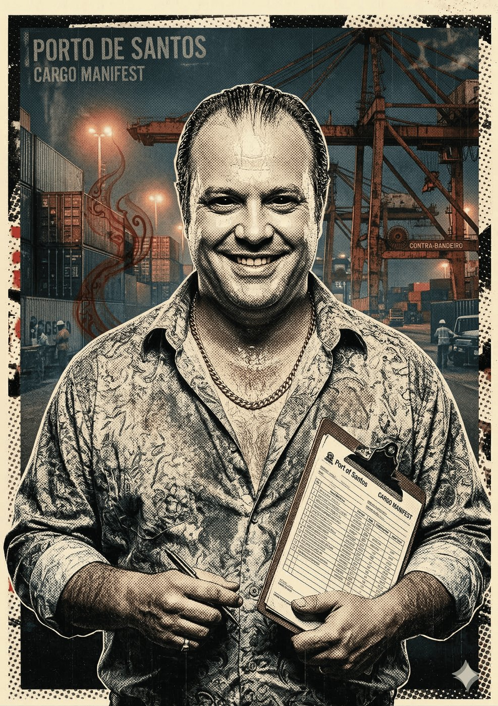

# Paizão — O Logístico

**Facção:** Secundários · **Clã:** Ministério · [Card no Trello](https://trello.com/c/qz9Wf1Vt)

#### **Paizão (Ministério) - O Logístico**

- **Função:** Empresário do Porto de Santos. Controla os contêineres e a fronteira marítima.
- **Paradas Excepcionais:** Finanças (Contrabando) 8, Manha 8, Persuasão 7.
- **Disciplinas-Chave:** _Presença 3_, _Ofuscação 2_, _Metamorfose 1_ (Olhos da Serpente).
- **O Truque:** Se vocês precisam entrar ou sair de uma zona quente sem serem escanerizados, o Paizão te bota num contêiner refrigerado com caixas de atum. Se o Príncipe Dante for derrubado, é o Paizão quem tem as chaves do cofre do porto.

---
_Texto e artes copiados do quadro Trello "Vampire - The Mascarade". Originais em alta resolução na pasta do projeto, em `trello/artes/originais/`._
