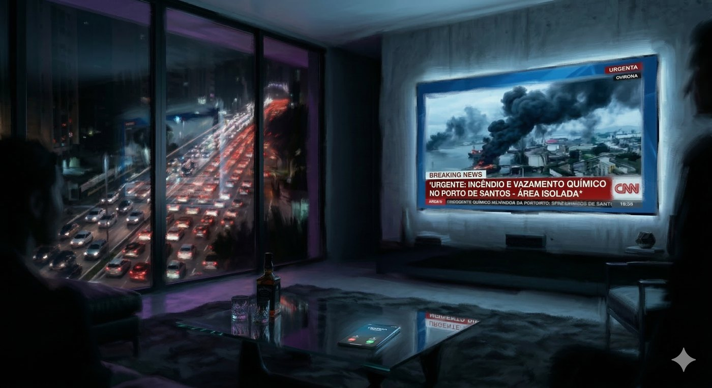

# Prólogo - O Loft

**Facção:** A Aventura · [Card no Trello](https://trello.com/c/VBjozgeY)

**Veredito:** É assim que se começa uma crônica de Vampiro. Nada de "vocês se encontram em uma taverna". Em V5, a gente começa com a Besta babando na nuca deles.

Aqui está o seu texto de abertura.

**Dica de Narrador Veterano:** Quando você for ler isso, mude a iluminação da sala, baixe o tom de voz e coloque uma trilha de _dark ambient_ (como a trilha de _Chernobyl_ ou _Sicario_) bem baixinha no fundo. Não tenha pressa. Deixe o desconforto bater.

---

### Prólogo: O Despertar (Texto para Leitura)

_(Leia ou parafraseie o texto abaixo para os jogadores)_

> "Vocês abrem os olhos de supetão, puxando um ar que os pulmões mortos de vocês não precisam. O teto de cimento queimado, as janelas do chão ao teto e os móveis de grife indicam que vocês estão no loft de luxo nos Jardins. O refúgio seguro de vocês.
>
> Mas a primeira coisa que os atinge não é o conforto. É a Fome. É um buraco negro no estômago, uma secura rasgando a garganta que faz as presas de vocês pulsarem contra a gengiva. _(Narrador: Peça para todos ajustarem a Fome de seus personagens para o Nível 4. Peguem 4 dados vermelhos. Eles já começam no limite)._
>
> Vocês estão limpos, as roupas estão perfeitas, mas os sentidos de vocês estão em curto-circuito. O ar do apartamento cheira a lavanda cara e ozônio do ar-condicionado, mas no fundo da garganta, no fundo da mente, há um cheiro fantasma grudado. Maresia pesada. Peixe podre. Fósforo químico queimado. Vocês não fazem ideia de onde esse cheiro vem, mas ele faz a Besta dentro de vocês se encolher de pavor.
>
> A segunda coisa que vocês notam é a dor. Na base do crânio (ou no pulso) de cada um de vocês, a pele morta repuxa. Há uma marca nova ali. Uma tatuagem de números finos, parecendo um código de barras bizarro, que emite uma luminescência roxa muito fraca, como luz negra. E ela queima. Não é uma dor mística; é uma queimação febril, quase mecânica, pulsando no mesmo ritmo da Fome de vocês. Vocês não lembram de terem feito isso. Vocês não lembram como voltaram para casa. A última lembrança clara que vocês têm é de semanas atrás.
>
> Antes que qualquer um de vocês consiga formular uma frase ou gritar, o silêncio do loft é rasgado. O celular em cima da mesa de centro de vidro vibra histericamente. A tela brilha na penumbra, iluminando um único nome no identificador de chamadas:
>
> **LUCIANA - SENESCAL**
>
> O telefone continua tocando. O que vocês fazem?"

---

### A Ação Imediata (O que acontece quando eles atendem)

Assim que o jogador mais corajoso (ou o mais burro) atender, você não diz "alô". Você interpreta a **Luciana**, fria como gelo:

> _"O Príncipe espera o relatório de vocês sobre os movimentos no Centro. Encontrem a Isadora no Elísio do MASP em uma hora. Não se atrasem. E... espero que o descanso de vocês tenha sido proveitoso. Vocês pareciam péssimos ontem à noite."_ E ela desliga. Sem dar chance de resposta.

**A Mecânica de Paranoia:** Se algum jogador disser "Eu uso _Auspícios_ para tentar lembrar" ou "Eu uso _Celeridade_ para correr até o espelho para ver a marca", narre isso:

> _"No exato segundo em que o sangue ferve para ativar a Disciplina, a tatuagem no seu pescoço brilha em um roxo intenso e a pele queima como se um cigarro fosse apagado ali. É instantâneo."_ (E nos servidores da ABIN da Inquisição, a Dra. Elisa acabou de registrar um pico térmico).

**Pronto.** O anzol está na boca deles. Eles estão famintos, marcados, sem memória e com a segunda mulher mais poderosa da cidade exigindo que eles compareçam a um evento de gala.

---
_Texto e artes copiados do quadro Trello "Vampire - The Mascarade". Originais em alta resolução na pasta do projeto, em `trello/artes/originais/`._
