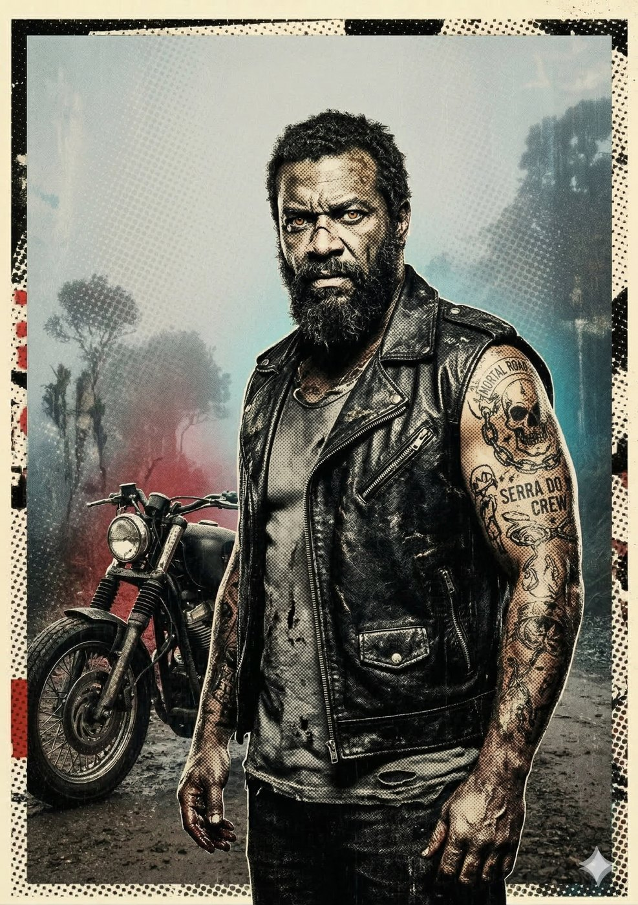

# Rayo — O Pista (Coyote)

**Facção:** Secundários · **Clã:** Gangrel · [Card no Trello](https://trello.com/c/VdckcHaG)

#### **Rayo (Gangrel) - O Pista (Coyote)**

- **Função:** Motoqueiro de estrada. A única rota de fuga segura de SP pra Baixada Santista/Litoral.
- **Paradas Excepcionais:** Condução (Fuga) 9, Sobrevivência (Mata Atlântica) 8, Briga (Corrente/Faca) 7.
- **Disciplinas-Chave:** _Fortitude 3_, _Proteanismo 2_ (Olhos da Besta).
- **O Truque:** A Inquisição fechou os pedágios da Rodovia dos Imigrantes? O Rayo coloca a Coterie em motos de trilha e desce a Serra do Mar no escuro absoluto, no meio da lama, sem farol.

#### **O idealista dos Anarchs (decisão do Peter, 2026-11-01)**

O Rayo é um dos grandes Anarchs de São Paulo e o único que ainda acredita de verdade na causa. Os outros Barões viraram tiranos (Nego, Guga) ou negociantes (Vincenzo, Harumi); o Rayo é leal a quem anda com ele, tem medo de ser lembrado como dedo-duro e não aceita dono. Esse contraste é o que dá peso à hipocrisia dos outros.

**Arco:** ao longo da história, o Rayo sobe aos poucos para o lugar do [Guga](../guga/) quando ele cai. Ele sobe meio a contragosto, ainda idealista, e fica a dúvida se o poder vai estragá-lo como estragou o Guga.

---
_Texto e artes copiados do quadro Trello "Vampire - The Mascarade". Originais em alta resolução na pasta do projeto, em `trello/artes/originais/`._
