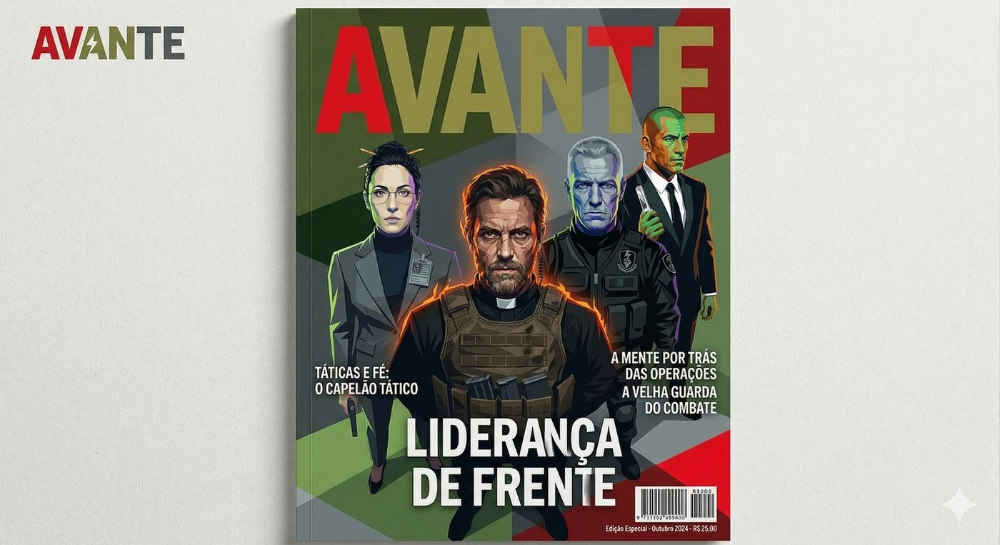

# Segunda Inquisição

**Facção:** Segunda Inquisição · [Card no Trello](https://trello.com/c/UW52hfUW)

_O card do Trello está vazio. O texto abaixo é o cânone do projeto para a Inquisição em São Paulo (decidido com o Peter em 2026-11-01)._

#### **O BOES**

Por fora, o BOES é um batalhão de operações especiais no molde da ROTA e do BOPE: tropa de elite famosa por caçar os grandes criminosos do estado. A imprensa, a polícia comum e até os próprios praças acham que é só isso. Ninguém de fora sabe qual é a treta de verdade. Por dentro, é a ponta armada da Segunda Inquisição no Brasil (Operação Veritas), com inteligência da ABIN (Dra. Elisa), apoio do Vaticano e comando do Coronel Machado.

#### **Como ela age (tom do V5)**

- **Inteligência antes de bala.** Celular, câmera, rede social, informante (o Biel era um). A Inquisição é paciente: marca, segue, mapeia e só depois ataca.
- **Fogo e luz do dia.** A batida de verdade é ao amanhecer, quando o vampiro dorme. Munição incendiária e fogo, porque chumbo não basta. No jornal do dia seguinte, vira "confronto com facção" ou "incêndio em operação contra o crime organizado".
- **Sigilo para os dois lados.** A Inquisição também esconde o que faz. Drone armado sobre a Paulista ou tiroteio de incendiária no meio da rua seria notícia, e notícia é o que ela evita.
- **Protocolo, não imunidade.** Ninguém é treinado para resistir à Dominação. O que existe é fone no ouvido, nunca olhar nos olhos, parceiro que vigia o parceiro e central que percebe quando alguém muda de comportamento.
- **Vampiro que negocia com a Inquisição está sendo usado.** O acordo do Dante com o Machado vale até o dia em que o Machado jogar a granada.

#### **O chip**

Fica embaixo da língua, com um código de barras tatuado por cima, e não dá para arrancar: o sangue fecha a carne de novo. O chip não sabe o que é Disciplina. Ele lê calor e sangue correndo. Corpo de vampiro é frio, e quando ele queima sangue (Disciplina, e um pouco na briga), a boca esquenta. É esse pico que o chip transmite para a Dra. Elisa.

---
_Texto e artes copiados do quadro Trello "Vampire - The Mascarade". Originais em alta resolução na pasta do projeto, em `trello/artes/originais/`._
