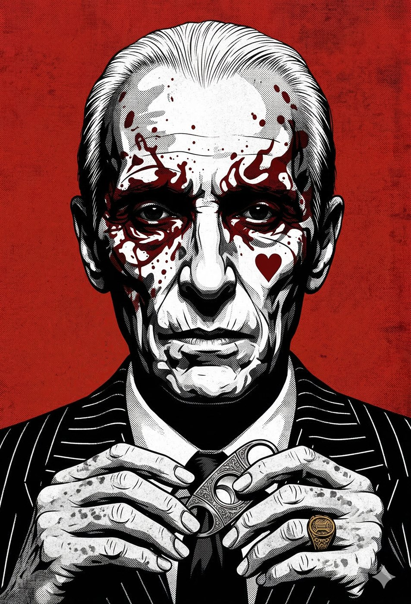
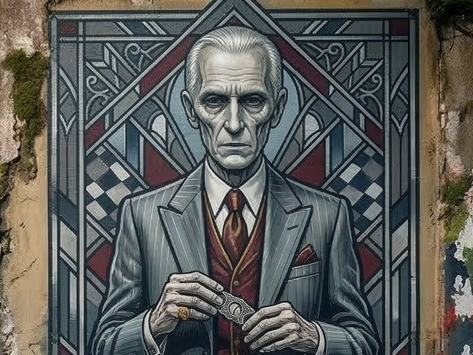
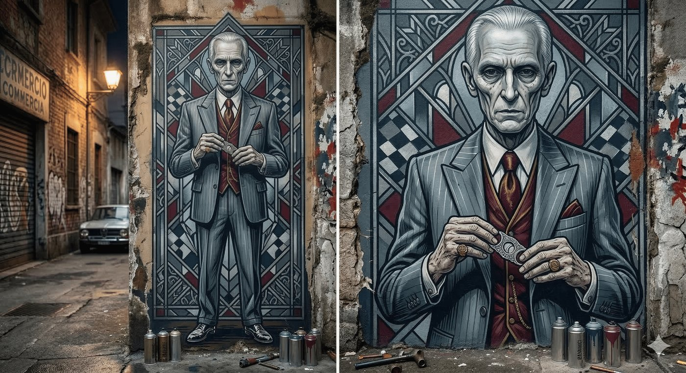
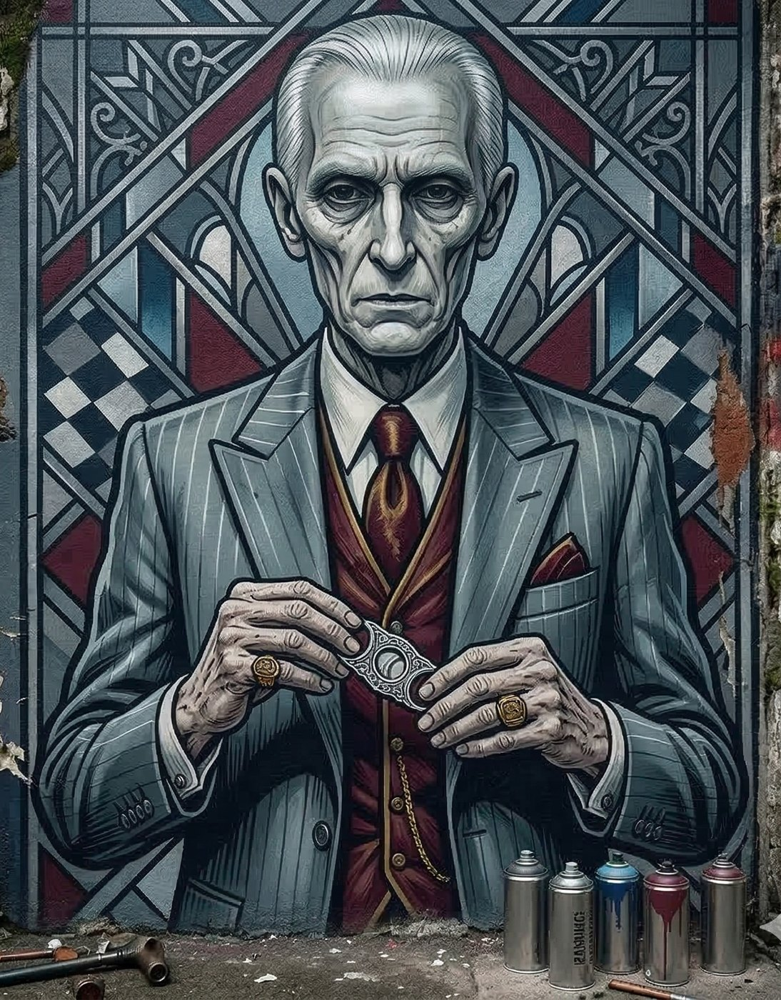

# Vicenzo — O Don do Sangue Frio

**Facção:** Anarchs · **Clã:** Hecata · [Card no Trello](https://trello.com/c/rF0IJEoH)

**Veredito:** Pedido anotado e aprovado. Se o Guga é a força bruta, suja de graxa e cheirando a diesel, o Vincenzo precisa ser a elegância cadavérica. Ele é o contraponto absoluto. Enquanto o Brujah resolve tudo na marretada e no grito, o Hecata resolve no sussurro, com uma taça de vinho na mão e um bisturi na outra.

Na V5, a Família Giovanni se uniu a outros necromantes para formar o Clã **Hecata**. Eles são a máfia que lida com os mortos. Em São Paulo, o Bixiga e a Mooca são os domínios perfeitos para um Patriarca que esconde seus crimes atrás de cantinas tradicionais e floriculturas de cemitério.

Aqui está a ficha do Don das Sombras.

---

### **Vincenzo: O Don do Sangue Frio**

- **Clã:** Hecata (Linhagem Giovanni).
- **Idade:** ~120 anos (Aparenta ter mais de 60. Abraçado na década de 1910, veio nos navios de imigrantes italianos para construir o império da família em São Paulo).
- **Posição:** Don Independente / Barão Velado (Bixiga & Mooca).
- **Fachada:** Um "padrinho" tradicional e empresário idoso que controla frigoríficos, funerárias e a máfia de caça-níqueis da zona leste e centro.
- **Realidade:** O maior "Limpador" do Mundo das Trevas paulistano. Ele comanda um esquema massivo de tráfico de órgãos de mortais e apagamento de provas criminais. Se um vampiro quebra a Máscara, Vincenzo cobra uma fortuna (em dinheiro ou favores sombrios) para desintegrar o corpo, limpar o sangue e calar os fantasmas das vítimas.

#### **História Resumida**

Vincenzo sobreviveu a um século de guerras vampíricas em São Paulo sendo útil para todo mundo e leal a ninguém. Quando a Camarilla e o Sabá se matavam nas ruas nos anos 90, os caminhões frigoríficos de Vincenzo passavam de madrugada recolhendo os corpos para que a polícia mortal não achasse nada. Ele enriqueceu com a guerra dos outros. Com a chegada da Segunda Inquisição (BOES), o negócio dele explodiu. A Camarilla e os Anarquistas estão desesperados para esconder seus rastros, e Vincenzo tem o monopólio da lixívia mística. Ele tolera o Padre Bernardo (Malkaviano) no Bixiga porque o padre atrai ovelhas perdidas, que Vincenzo frequentemente "ajuda a desaparecer" quando as cantinas precisam de carne nova para o mercado clandestino de órgãos.

#### **Percepção dos Outros**

- **Guga (Brujah):** "Um velho nojento que fede a formol. Os capangas dele andam de terno na minha área achando que mandam. Um dia eu quebro aquele sorriso fino dele no meio."
- **Constance (Lasombra):** "Nós falamos a mesma língua: o lucro. Mas a moeda dele é suja demais para os meus bancos. Eu o contrato quando preciso que uma testemunha evapore, mas jamais aperto a mão dele."
- **A Coterie:** "O mal necessário. Quando a poça de sangue ficar grande demais e a Inquisição estiver batendo na porta, é o número do Vincenzo que a gente vai ter que discar."

#### **O Gatilho Funerário (Horror Hook para a Mesa)**

O horror do Vincenzo é a **Comodificação da Morte**. Ele não mata por raiva, ideologia ou mesmo pela Fome; ele mata porque um rim saudável mortal vale 80 mil reais, e a alma atormentada pode ser escravizada para espionar a polícia. Se a Coterie precisar que ele apague o rastro deles nos servidores do BOES (ou suma com um corpo), Vincenzo não pedirá favores heróicos. Ele pedirá que a Coterie entregue para ele uma criança humana com um tipo sanguíneo raro, viva, apenas porque "os negócios exigem". Ele força a humanidade dos jogadores a apodrecer.

---

### **Descrição Visual (Para ler na mesa)**

> "O contraste com as ruas do Guga é imediato. Vocês são recebidos nos fundos de uma cantina tradicional na Mooca, em uma sala com painéis de madeira escura, poltronas de couro legítimo e o cheiro forte de charuto toscano misturado com um leve e perturbador toque de lavanda e formol.
>
> Sentado atrás de uma mesa de mogno está o Don Vincenzo. Ele é exatamente o oposto do que vocês esperariam de um chefe de rua. Ele é alto, esguio feito uma garça, com a pele pálida esticada sobre ossos finos que lhe dão um aspecto aristocrático e cadavérico. Os cabelos são brancos, ralos e penteados perfeitamente para trás. Ele veste um terno italiano risca-de-giz impecável, sapatos de cromo alemão e um anel de ouro pesado no dedo anelar. O rosto dele é inexpressivo, os olhos são poços escuros e calmos. Ele não levanta a voz. As mãos dele, que brincam com um cortador de charutos de prata, são gélidas e cheias de manchas da idade, com dedos longos de pianista. Ele sinaliza para os dois seguranças de terno encostados na porta saírem, junta as pontas dos dedos finos e sussurra: _'Dizem que os ventos do porto trouxeram fantasmas novos para a minha cidade. Em que a Família pode ajudar os esquecidos da Torre hoje?'_"

---

### **Ficha Mecânica (V5 NPC - O Padrinho Necromante)**

_(Para quando a Coterie tentar invadir o território dele, ou se precisarem lidar com as magias de morte)_

- **Dificuldade Base:** 5 (Socialmente e mentalmente, ele é uma fortaleza. Bater de frente na política com ele é inútil).
- **Paradas de Dados Padrão:** Físico 3, Mental 6, Social 7.
- **Atributos Secundários:** Vitalidade 6, Força de Vontade 8.
- **Paradas de Dados Excepcionais:** * _Persuasão / Intimidação (Velada):_ 9
  - _Finanças / Subterfúgio:_ 8
  - _Ocultismo (Necromancia):_ 8
  - _Armas de Fogo (Pistola com silenciador):_ 5

**Equipamento Especial & Disciplinas:**

- **A Perdição Hecata (Bane):** O beijo de um Hecata não causa prazer, causa uma dor excruciante. Vincenzo se alimenta apenas de mortais contidos ou em estado de choque, geralmente nas macas frias de seus abatedouros.
- **Oblivion 4:** * _Aura de Decadência (Aura of Decay):_ Plantas murcham e metais enferrujam perto dele se ele quiser.
  - _O Toque do Abismo (Touch of Oblivion):_ Se a diplomacia falhar e ele tocar em um jogador, ele não dá um soco; o braço do jogador necrosa instantaneamente, causando **Dano Agravado**.
  - _Passo Sombrio (Shadow Step):_ Ele pode desaparecer pelas sombras do escritório se for encurralado.
- **Auspícios 3:** * _Ler a Alma (Scry the Soul):_ Ele consegue ver a teia de mentiras e o terror da Inquisição na aura da Coterie assim que eles entram na sala. É impossível mentir para ele impunemente.
- **A "Limpeza" (Recursos 5 / Contatos 5):** Ele tem legiões de mortais trabalhando para a Máfia. Policiais corruptos, legistas, donos de lixões e advogados. Se Vincenzo estalar os dedos, uma prova criminal envolvendo a Coterie simplesmente deixa de existir no sistema mortal.

---

**Dica de Narrador:** O Vincenzo é o botão de emergência perfeito. Se os jogadores fizerem uma cagada monumental no **Capítulo 2** (matarem muita gente no Curral e o BOES estiver descendo pra cima deles), o Padre Bernardo pode sugerir que eles "comprem um caixão do Vincenzo". Vincenzo esconderá a Coterie e limpará a bagunça, mas a dívida de sangue que eles vão adquirir com o Hecata será um pesadelo que assombrará as próximas crônicas inteiras.

## Outras artes

---
_Texto e artes copiados do quadro Trello "Vampire - The Mascarade". Originais em alta resolução na pasta do projeto, em `trello/artes/originais/`._
